# h1 Hei Ansiblen maailma 

## x) Lue ja tiivistä

### Artikkeli 1.

**Karvinen 2026: SSH public key - Login without password**

Tässä artikkelissa kerrotaan, miten SSH asennetaan, testataan, ja miten julkisen avaimen avulla voi kirjautua automaattisesti.

Artikkelissa käydään seuraavat vaiheet:
- SSH:n asennus ja testaus. Ensiksi asennetaan SSH, sen jälkeen testataan toimiiko se.
- Automaattinen kirjautuminen SSH julkisen avaimen avulla. Aloitetaan luomalla avainpari, jos sellaista ei jo ole. Tämän jälkeen kopioidaan julkinen avain etäkoneeseen ja sen jälkeen pystytään kirjautumaan antamatta salasanaa.
- Lopussa on myös muutama komento vikatilanteita varten, sekä asiakas- että palvelinpuolella.

**Keskeiset komennot**
```
sudo apt-get -y install ssh
sudo systemctl enable --now ssh
ssh localhost
ssh-keygen	
ssh-copy-id localhost
sudo journalctl --follow
sudo systemctl status ssh
```

**Oma kysymys tai huomio**

Kiinnitin huomiota tähän lauseeseen `"Use correctly, it can also make your server more secure"`, koska oma kokemukseni on, että harvoin tätä tehdään oikein. Sen vuoksi pidän SSH:ta semi-riskinä ratkaisuna. Ymmärrän kuitenkin, että se on erittäin turvallinen teknisesti ja teknologiana. Monesti riskit, joita SSH voi aiheuttaa (avainten hallitsematon leviäminen, portin 22 avaaminen, sekä heikosti auditoitavissa, jne.) ovat tyypillisesti ihmisten toimien aiheuttamia. Tämän vuoksi omissa järjestelmissä luotan enemmän "service-initiated ZTNA" -ratkaisuihin, kuten esimerkiksi AWS SSM Session Manager. Tällöin tietoturvaraja tai vastuu siirtyy täysin IAM:iin (toki siinäkin on omat riskinsä). Toisin sanoen, jos olen herännyt ennen yöllä kaksi kertaa painajaisiin (kun SSH on käytössä ja IAM on konfattu päin persettä), niin nyt joudun herätä vain yhteen painajaiseen IAM:sta, joka on voitto minun kirjassani :D

**Lähteet**

[Karvinen 2026: SSH public key - Login without password](https://terokarvinen.com/ssh-public-key-login-without-password/)


### Artikkeli 2.

**Karvinen 2026: Hello Ansible**

Tämä artikkeli on Ansiblen tutoriaali, se on konfiguraationhallintatyökalu. Keskeisenä ajatuksena tässä on idempotenssi. Eli sama konfiguraatio voidaan ajaa toistuvasti, se muuttaa konetta vain, jos kone poikkeaa halutusta tilasta. Ansible on agentiton, hallintaan tarvitsee vain SSH-demonin ja Pythonin.

Artikkelissa käydään seuraavat vaiheet:
- Ansiblen asennus. Tässä vaiheessa tarvitaan oikeastaan vain Ansible, mutta muut paketit helpottavat työskentelyä (Micro: teksti-editori, bash-completion: tabulaattorilla voi täydentää kirjoitettavan käskyn, tree: näyttää tiedosto- ja kansiopuun)
- Ansiblen testaus. Tässä vaiheessa testataan, että Ansible pystyy suorittamaan komentoja localhostissa.
- Ansiblen asetusten muuttaminen. Ansible varoittaa Pythonin versiosta, joten tästä ilmoituksesta pääsee eroon muokkaamalla hieman Ansiblen asetuksia. Toinen asia, mikä kannattaa muuttaa, on se ettei joka kerta tarvitse kirjoittaa `-i hosts.ini` jokaiseen komentoon. Tämän pystyy helposti muokata lisäämällä `hosts.ini` ansiblen cfg-tiedostoon.
- Roolin luonti. Site.yml tiedostoon luodaan rooli hello. Rooli on yksi kokonaisuus konfiguraatiota (esim. yhden palvelun asennus ja asetukset). Jorkut voi vaatia sudoa.
- Lopputulos. Tässä vaiheessa laitetaan Ansible tulostamaan, mitä se tekee. Kaiken kaikkiaan luotiin 4 kansiota ja 4 tiedostoa. Tämän kaiken voi lopuksi suorittaa yhdellä komennolla (`ansible-playbook site.yml`).
- Vikatilanteet. Tässä käydään läpi yleisimmät vikatilanteet ja mitä niissä kannattaa tehdä.

**Keskeiset komennot**
```
sudo apt-get install ansible micro bash-completion tree
ansible all -a 'uptime' -i hosts.ini
ansible-playbook site.yml
ansible all -a "uptime"
ansible-playbook site.yml --ask-become-pass
```
**Oma kysymys tai huomio**

Sinänsä on aika selkeä, pitäisi kokeilla itse pari kertaa käytännössä.

**Lähteet**

[Karvinen 2026: Hello Ansible](https://terokarvinen.com/hello-ansible/)


## a) Debianin paikallinen asennus

[Debianin asennus raportti](https://dimi-viitakoski.github.io/palvelinten-hallinta/h0/h0.html)


## b) Sshecrets 

### Ensin asensin SSH-palvelun.
```
sudo apt install ssh -y
```

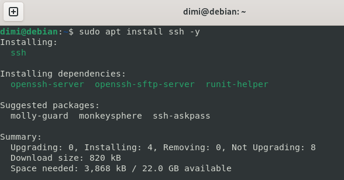

### Käynnistin SSH-palvelun, asetin sen käynnistymään automaattisesti ja tarkistin sen tilan.
```
sudo systemctl enable --now ssh
sudo systemctl status ssh
```

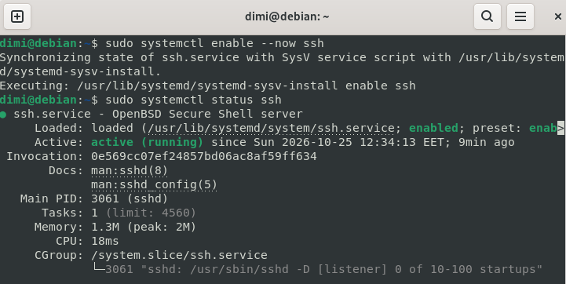

### Testasin SSH:n toimintaa ottamalla yhteyden localhostiin. Kun SSH kysyi, luotetaanko palvelimen avaimeen, vastasin `yes`. Lopuksi tarkistin `w`-komennolla, että olin kirjautuneena koneelle kahdesti, työpöydän kautta ja SSH:lla.
```
ssh localhost
w
```

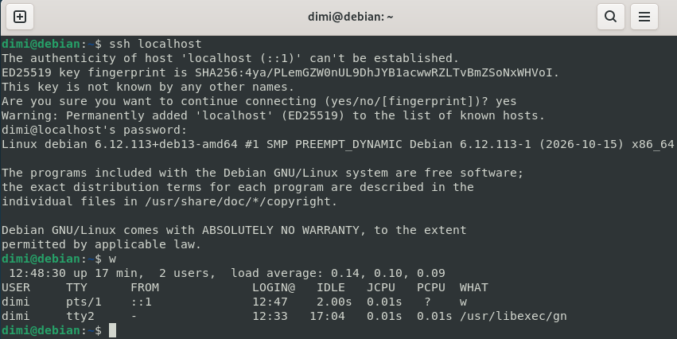


## c) Pubkey

### Seuraavaksi automatisoin SSH-kirjautumisen julkisella avaimella. Avainpari oli jo luotu aiemmin, joten en ylikirjoittanut sitä. Kopioin julkisen avaimen palvelimelle ja testasin, että salasanaa ei enää kysytty.
```
ssh-keygen
ls -l ~/.ssh
ssh-copy-id locaclhost
ssh localhost
w
```

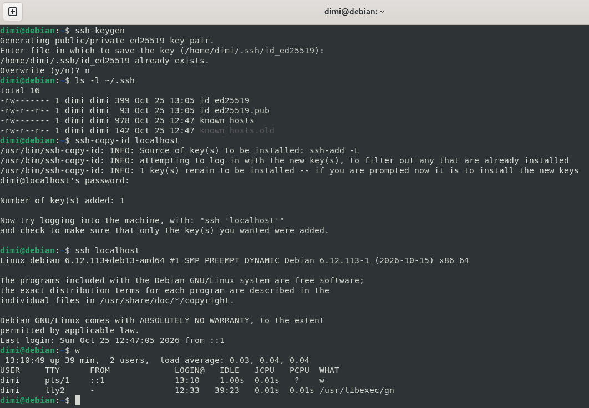


## d) Hei Ansible

### Ensin asensin Ansiblen ja treen sekä tarkistin asennetun Ansiblen version.
```
sudo apt install ansible tree -y
ansible --version
```

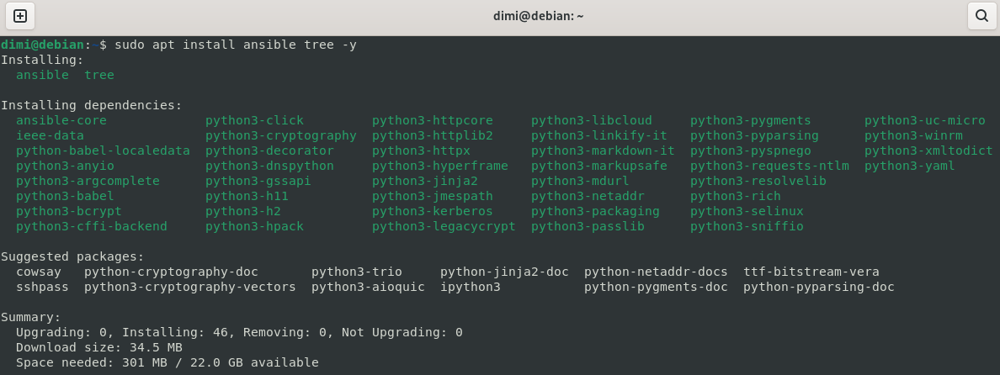

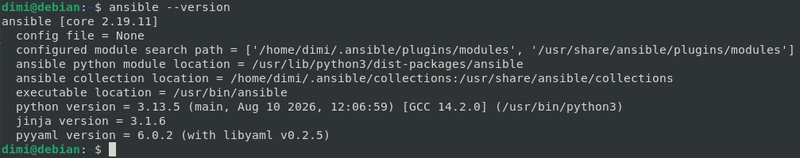

### Seuraavaksi loin Ansiblelle projektihakemiston ja siihen inventaariotiedoston, johon tulevat ansiblen hallitsemat koneet.
```
mkdir ansible
cd ansible
nano hosts.ini
```

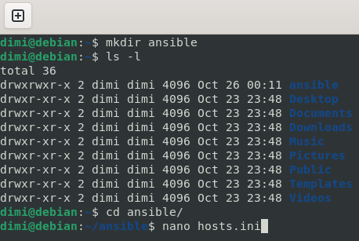

### Kirjoitin kyseisen tiedostoon hallittavan koneen nimen sekä Python-tulkin polun (joka poistaa ansiblen varoituksen automaattisesti tunnistetusta python-versiosta). Lopuksi tallensin tiedoston ja testasin yhteyden ajamalla uptime-komennon kaikilla inventaarion koneilla.
```
nano hosts.ini
cat hosts.ini
ansible all -a 'uptime' -i hosts.ini
```
```
# hosts.ini tiedosto

localhost

[all:vars]
ansible_python_interpreter=/usr/bin/python3
```

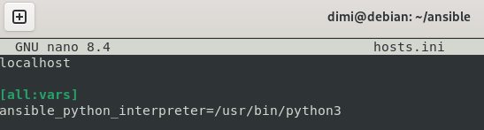

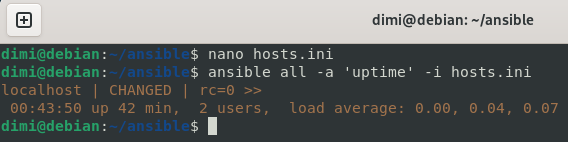

### Seuraavaksi loin Ansiblen konfiguraatiotiedoston ja määritin siihen `hosts.ini`-tiedoston oletusinventaarioksi, tällöin `-i hosts.ini` ei tarvitse kirjoittaa joka kerta (`-i` siis kertoo, mitä inventaariotiedostoa käytetään). Lopuksi tallensin tiedoston ja testasin komennon ilman valitsinta.
```
nano ansible.cfg
ansible all -a 'uptime'
```
```
# ancible.cfg tiedosto

[defaults]
inventory = hosts.ini
```

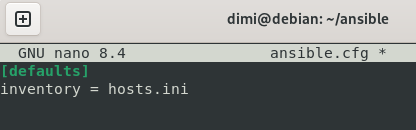

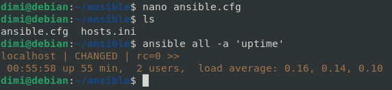

### Loin playbook-tiedoston, joka kertoo, mitkä roolit ajetaan millekin koneille. Rooli on siis yksi kokonaisuus konfiguraatiota (esim. yhden palvelun asennus ja asetukset). Kun ajoin playbookin, tuli odotetusti virhe, koska hello-roolia ei ollut vielä luotu.
```
nano -E site.yml
# jos joku ihmettelee, niin -E on --tabstospaces se muuttaa sarkaimet välilyönneiksi, koska YAML ei salli sarkaimia sisennyksissä

ansible-playbook site.yml
```
```
# site.yml tiedosto

- hosts: all
  roles:
    - hello
```

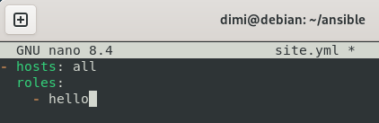

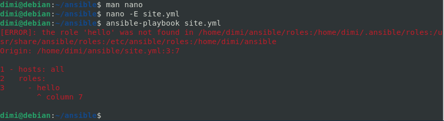

### Loin `hello` roolille kansion ja tehtävätiedoston. Ajoin playbookin kahdesti, ensimmäisellä kerralla Ansible loi tiedoston ja toisen kerran tiedosto oli jo halutussa tilassa, eli idempotenssi.
```
mkdir -p roles/hello/tasks/
nano -E roles/hello/tasks/main.yml
ansible-playbook site.yml
```
```
# main.yml tiedosto

- copy:
    dest: /tmp/hello-ansible
    content: "hello ansible!\n"
```

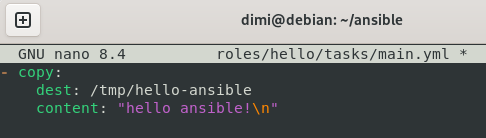

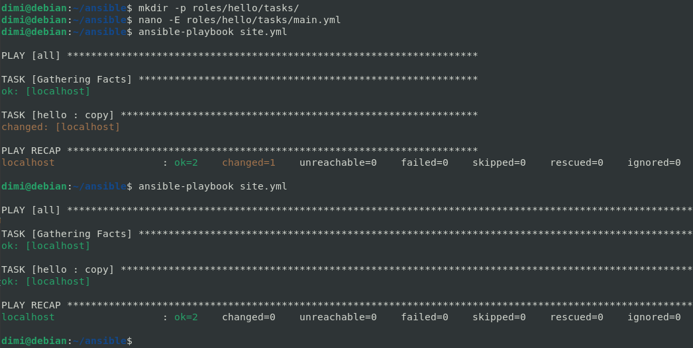


### Tarkistin vielä SSH:lla, sekä tulostin harjoituksen lopputuloksen.
```
ssh localhost 'cat /tmp/hello-ansible'
tree -F
head -1000 ansible.cfg hosts.ini site.yml roles/hello/tasks/main.yml
```

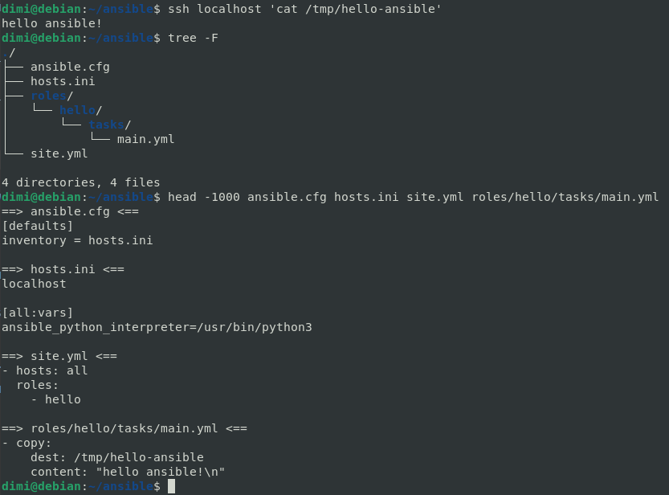


## e) Vapaaehtoinen bonus

### Päätin asentaa `cowsay` Ansiblella. Loin uuden packages-roolin, jossa apt varmistaa, että `cowsay` on asennettuna.
```
mkdir -p roles/packages/tasks/
nano -E roles/packages/tasks/main.yml
```
```
# main.yml tiedosto

- apt:
    name: cowsay
    state: present
```

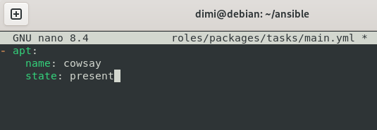

### Lisäsin playbookiin packages-roolin, sekä rivin `become: true` jolloin Ansible ajaa tehtävät sudolla (pakettien asennus vaatii pääkäyttäjän oikeudet).
```
nano -E site.yml
```
```
# site.yml tiedosto
- hosts: all
  become: true
  roles:
    - hello
    - packages
```

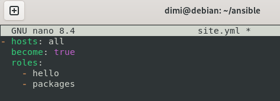

### Ajoin playbookin. Lisäsin `--ask-become-pass` jolloin Ansible kysyi sudo-salasanan ennen ajoa.

```
ansible-playbook site.yml --ask-become-pass
```

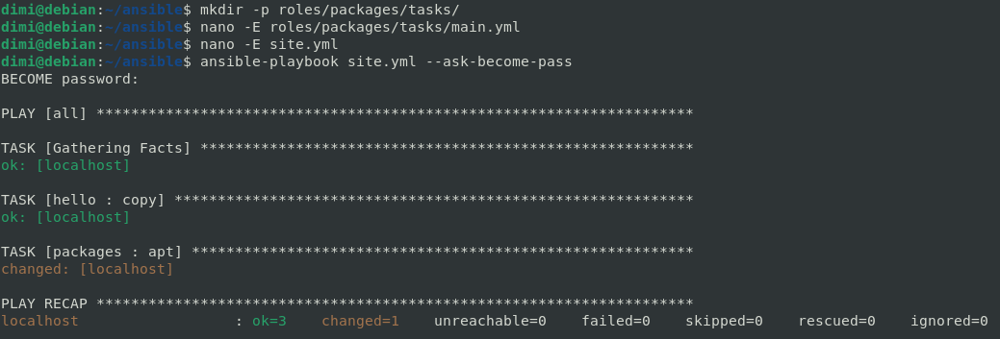

### Toisella ajolla Ansible tulosti lehmät :)
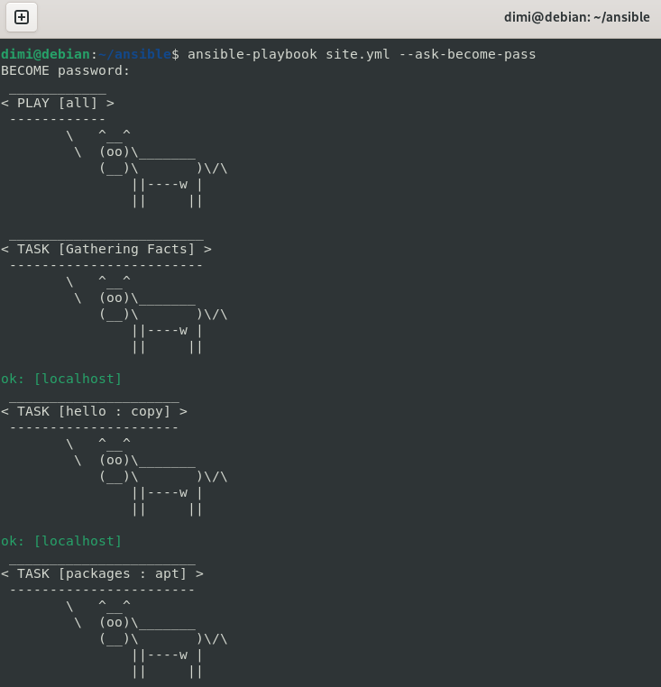

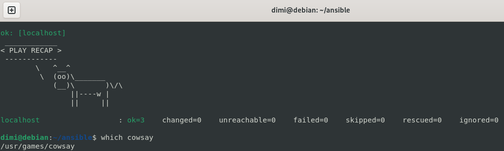

### Valmis!

## Teknisiä vaikeuksia

Minulla ei ollut tässä tehtävässä teknisiä vaikeuksia muita kun pikku typoja niissä pitäis olla tarkkana.


## Lähteet:
[Karvinen 2026: Palvelinten Hallinta](https://terokarvinen.com/palvelinten-hallinta/)
