# h2 Voileipä

## x) Lue ja tiivistä

### Artikkeli 1.

**Karvinen 2026: Sudo without password**

Ansible tarvitsee root-oikeudet hallittavalla koneella. Yksi tapa on sallia sudon käyttö ilman salasanaa, jolloin Ansible voi ajaa ylläpitokomentoja automaattisesti ilman, että kenenkään tarvitsee kirjoittaa salasanaa kesken ajon. Artikkelissa tämä tehdään manuaalisesti uudelle käyttäjälle.

- Ensimmäisenä luodaan käyttäjä `antero` ja ryhmä `sudoless`. Sitten lisätään käyttäjä ryhmään.
- Seuraavaksi avataan toinen terminaali-ikkuna rootina `sudo -i` -komennolla. Jos sudon asetukset menevät rikki, niitä ei voi enää korjata sudolla, joten auki jätetty root-shelli toimii varmuuskeinona.
- Sitten luodaan `visudo`-komennolla tiedosto `/etc/sudoers.d/sudoless` ja kirjoitetaan siihen sääntö, jonka mukaan `sudoless`-ryhmän jäsenet saavat ajaa kaikkia komentoja ilman salasanaa. `visudo` tarkistaa säännön ennen tallennusta.
- Säännön osat: `%sudoless` tarkoittaa ryhmää, ensimmäinen `ALL` kaikkia koneita, `(ALL)` sitä, että komennon saa ajaa minä tahansa käyttäjänä (myös rootina), `NOPASSWD` sitä, ettei salasanaa kysytä, ja viimeinen `ALL` kaikkia komentoja.
- Sen jälkeen testataan kirjautumalla käyttäjänä `antero`. Ryhmämuutos tulee voimaan vasta uudelleenkirjautumisen jälkeen. `sudo -k` tyhjentää sudon muistiin jääneen salasanan, jotta testi on luotettava. Lopuksi ajetaan jokin sudo-komento (esim. `echo`) ja se toimii kysymättä salasanaa.

**Keskeiset komennot**

```
sudo adduser antero
sudo groupadd sudoless
sudo adduser antero sudoless
sudo -i
sudo visudo /etc/sudoers.d/sudoless

# sääntö
%sudoless ALL = (ALL) NOPASSWD: ALL

ssh antero@localhost
sudo -k
```

**Oma kysymys tai huomio**

Kätevää, mutta vaarallista. Kun salasanaa ei kysytä, kuka tahansa jolla on SSH-avain on tavallaan root. Sitä varmaan kannattaa jotenkin rajata oikeassa maailmassa.

**Lähteet**

[Karvinen 2026: Sudo without password](https://terokarvinen.com/passwordless-sudo/)


### Artikkeli 2.

**Munroe 2006: xkcd 149: Sandwitch**

Tässä on meemi sudosta. Pointti on siinä, että sudo toimii kuin taikasana, jolla saa pääkäyttäjän valtuudet.


**Keskeiset komennot**

```
sudo
```

**Oma kysymys tai huomio**

Sopii hyvin tämän viikon aiheeseen.

**Lähteet**

[Munroe 2006: xkcd 149: Sandwitch](https://xkcd.com/149/)


### Artikkeli 3.

**Karvinen 2026: Passwordless Sudo with Ansible**

Tässä artikkelissa käsitellään periaatteessa samaa asiaa kuin artikkelissa 1, mutta automatisoituna Ansible-roolina.

- `antero`-roolissa on neljä tehtävää:
  - `group` luo `sudoless`-ryhmän.
  - `user` luo käyttäjän `antero` ryhmiin `sudoless`, `sudo` ja `adm`.
  - `authorized_key` lisää käyttäjälle julkisen SSH-avaimen.
  - `copy` kirjoittaa sudoers-säännön tiedostoon `/etc/sudoers.d/sudoless`.
- Vinkit: 
  - Kun asia toimii manuaalisesti (tai siis kun osaat tehdä sen manuaalisesti itse), polut ja tiedostojen sisällöt voi kopioida suoraan automaatioon.
  - Oikeuksia ei pidä arvata, vaan ne tarkistetaan `stat`-komennolla. Oikeudet kannattaa antaa oktaalina lainausmerkeissä ja etunollalla, esim. `0644`.

**Keskeiset komennot**
```
# antero rooli
- group:
    name: "sudoless"
    state: present
- user:
    name: "antero"
    state: present
    groups: ["sudoless", "sudo", "adm"]
- authorized_key:
    user: "antero"
    key: "ssh-ed25519 U2VlIHlvdSBhdCBUZXJvS2FydmluZW4uY29tIQ== tero@example.com"
- copy:
    dest: "/etc/sudoers.d/sudoless"
    content: "%sudoless ALL = (ALL) NOPASSWD: ALL\n"
    owner: "root"
    group: "root"
    mode: "0644"

ansible-playbook site.yml
ansible-playbook site.yml --ask-become-password
```

**Oma kysymys tai huomio**

Pitää muistaa vaihtaa oma SSH-avain tilalle.

**Lähteet**

[Karvinen 2026: Passwordless Sudo with Ansible](https://terokarvinen.com/passwordless-sudo-with-ansible/)


### Ansiblen sisäänrakennettu dokumentaatio.

Tässä osiossa käydään läpi Ansiblen dokumentaatiota ja annetaan esimerkkejä komennoista.

**copy:** kopioi tiedoston tai kirjoitetun sisällön hallittavalle koneelle.

- `src`: kopioitava tiedosto ohjaavalla koneella (roolissa sen `files/`-kansiosta)
- `content`: kirjoittaa annetun tekstin suoraan tiedostoon `src`:n sijaan
- `dest`: tiedoston polku hallittavalla koneella, pakollinen
- `owner`, `group`: tiedoston omistava käyttäjä ja ryhmä
- `mode`: tiedoston oikeudet, esimerkiksi `"0644"`

Esimerkki kopioi tiedoston /srv/myfiles/foo.conf ohjaavalta koneelta hallittavan koneen polkuun /etc/foo.conf ja asettaa sen omistajaksi ja ryhmäksi foo sekä oikeuksiksi 0644.

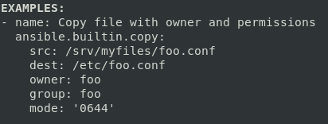

**apt:** moduuli Linuxin apt-paketinhallintaan.

- `name`: hallittava paketti, voi olla myös lista paketeista
- `state`: haluttu tila: `present` (asennettu), `absent` (poistettu) tai `latest` (asennettu ja päivitetty uusimpaan versioon)
- `update_cache`: ajaa `apt-get update` -komennon ennen asennusta, toimii myös yksinään ilman `name`

Esimerkki asentaa Apache-weppipalvelimen paketin apache2.

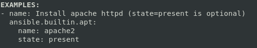

**file:** hallitsee tiedostoja, hakemistoja ja linkkejä sekä niiden ominaisuuksia kirjoittamatta sisältöä.

- `path`: hallittavan tiedoston tai hakemiston polku, pakollinen
- `recurse`: kun `state: directory`, asettaa omistajan, ryhmän ja oikeudet myös kaikelle hakemiston sisällölle
- `src`: kun `state: link`, tiedosto, johon linkki osoittaa
- `state`: mikä polun pitäisi olla: `file` (oletus, tiedoston pitää olla jo olemassa), `directory`, `link`, `touch` (luo tyhjän tiedoston) tai `absent` (poistaa)
- `owner`, `group`: tiedoston omistava käyttäjä ja ryhmä
- `mode`: tiedoston oikeudet, esimerkiksi `"0644"`

Esimerkki muuttaa olemassa olevan tiedoston `/etc/foo.conf` omistajaksi ja ryhmäksi `foo` sekä oikeuksiksi `0644`.

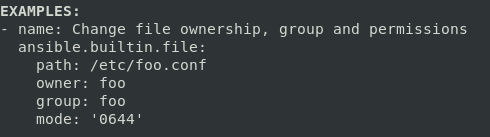

**user:** hallitsee käyttäjätunnuksia.

- `name`: käyttäjänimi, pakollinen
- `create_home`: luodaanko käyttäjälle kotihakemisto
- `comment`: kuvauskenttä, yleensä käyttäjän koko nimi
- `groups`: lista ryhmistä, joihin käyttäjä lisätään
- `shell`: käyttäjän shell, esimerkiksi `/bin/bash`
- `state`: `present` luo käyttäjän, `absent` poistaa sen
- `system`: luo järjestelmätunnuksen, joka on tarkoitettu palveluille

Esimerkki luo käyttäjän johnd ja hänelle kotihakemiston.

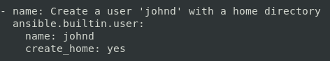

**authorized_key:** lisää tai poistaa julkisia SSH-avaimia käyttäjän `~/.ssh/authorized_keys`-tiedostosta.

- `user`: kenen `authorized_keys`-tiedostoa muutetaan, pakollinen
- `key`: julkinen avain, pakollinen

Esimerkki lisää käyttäjälle `charlie` julkiset SSH-avaimet, jotka haetaan suoraan GitHubin osoitteesta `github.com/charlie.keys`, jolloin `charlie` voi kirjautua koneelle niillä avaimilla.

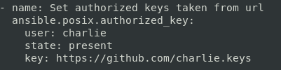

**Oma kysymys tai huomio**

Tässä on aika paljon opittavaa ja aika paljon hyödyllisiä ominaisuuksia, joita voisi kokeilla.

**Lähteet**

```
ansible-doc copy
ansible-doc apt
ansible-doc file
ansible-doc user
ansible-doc authorized_key
```


## a) Sudoless

#### Ensin loin käyttäjän `ansible` ja asetin sille salasanan. Jätin lisätietokentät tyhjiksi. Sitten loin `sudoless`-ryhmän ja lisäsin käyttäjän siihen. Lopuksi tarkistin `id`-komennolla, että käyttäjä kuuluu oikean ryhmään.

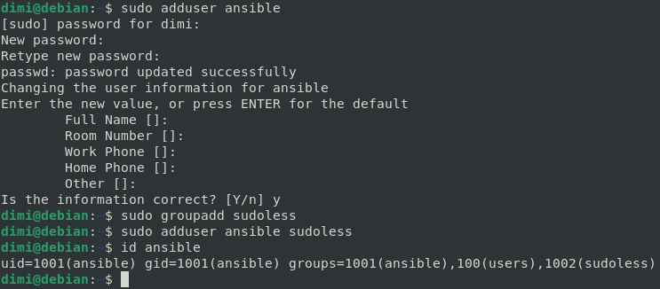

```
sudo adduser ansible
sudo groupadd sudoless
sudo adduser ansible sudoless
id ansible
```

#### Avasin toisen terminaalin rootina. Jos jotenkin rikon sudon asetukset, en voi enää korjata niitä sudolla, joten tämä on hyvä varmuuskeino.

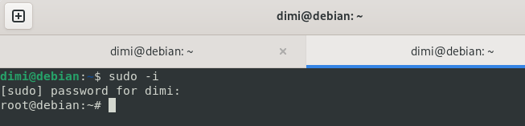

```
sudo -i
```

#### Seuraavaksi loin `sudoless` tiedoston `sudoers.d` hakemistoon ja kirjoitin siihen uuden säännön (`sudoless`-ryhmän jäsenet saavat ajaa kaikilla koneilla minkä tahansa komennon minä tahansa käyttäjänä ilman salasanaa). Käytin tähän `visudo`-komentoa, se tarkistaa syntaksin ennen tallennusta.

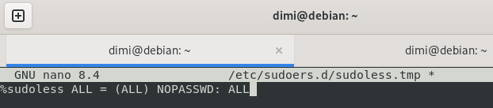

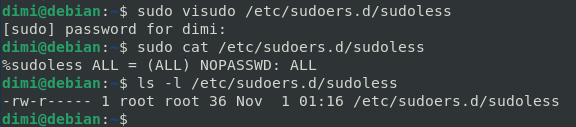

```
sudo visudo /etc/sudoers.d/sudoless

# sudoless tiedosto
%sudoless ALL = (ALL) NOPASSWD: ALL

# tarkistus
sudo cat /etc/sudoers.d/sudoless
ls -l /etc/sudoers.d/sudoless
```

#### Otin SSH-yhteyden `ansible`-käyttäjänä ja testasin sudoa. `sudo -k` tyhjentää sudon muistaman salasanan. `sudo whoami` tulosti `root` kysymättä salasanaa, eli salasanaton sudo toimi.

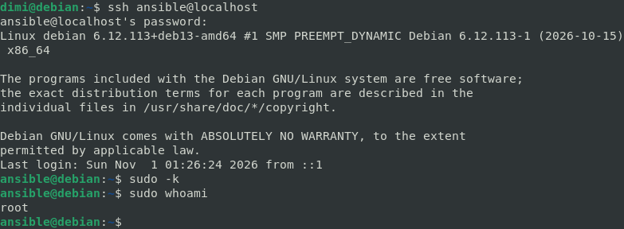

```
ssh ansible@localhost
sudo -k
sudo whoami
```

#### Seuraavaksi yritin määrittää Ansiblen kirjautumaan `ansible`-käyttäjänä, lisäämällä asetustiedostoon `remote_user = ansible`. Ajoin testikomennon ja sieltä tulikin ensimmäinen oikea virhe. Onneksi sitä ei tarvinnut miettiä kauheasti, kun Tero näytti jo kaikki mahdolliset virheet viime luennolla. En siis kopioinut julkista avainta `ansible`-käyttäjälle.

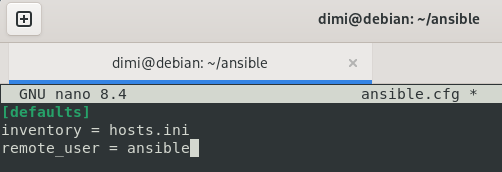

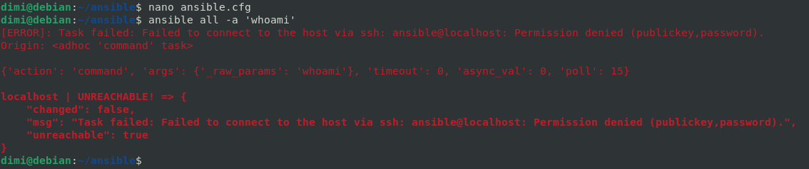


```
nano ansible.cfg

# ansible.cfg tiedosto
[defaults]
inventory = hosts.ini
remote_user = ansible

ansible all -a 'whoami'
```

#### Korjasin virheen kopioimalla julkisen avaimen `ansible`-käyttäjälle ja ajoin testit uudelleen. Ensiksi `whoami` tulosti `ansible`, eli Ansible kirjautui uutena käyttäjänä avaimella. `-b` eli `become` ajaa komennon sudolla ja tulostaa `root` (tarvin `-b`:n erikseen, koska komento ei lue `site.yml`-tiedoston `become`-asetusta). Lopuksi ajoin koko playbookin ilman `--ask-become-pass` ja se toimii ilman salasanaa.

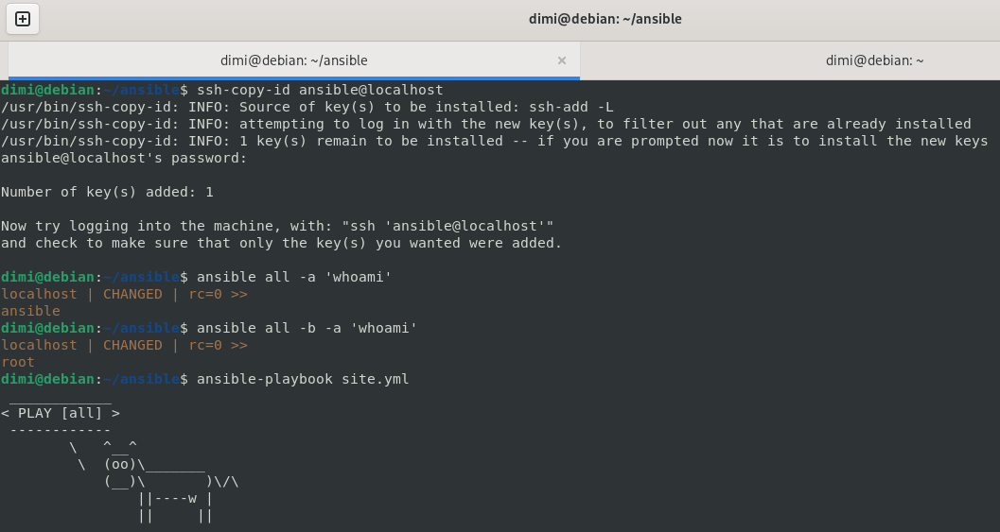

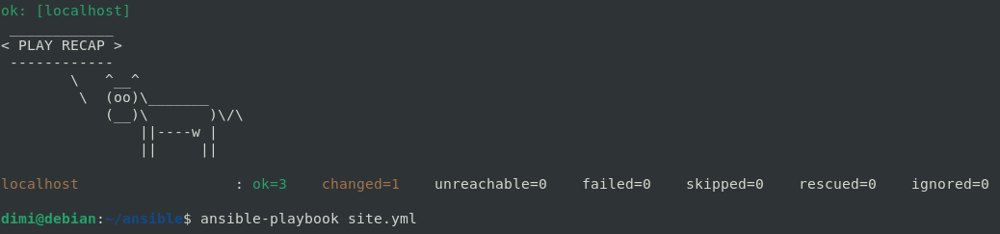

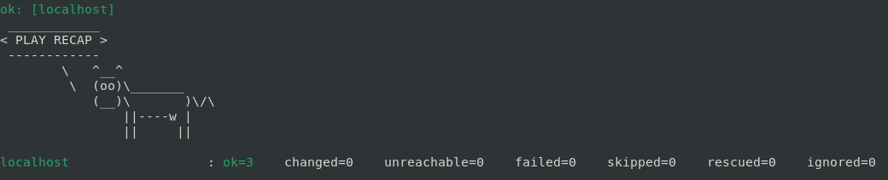

```
ssh-copy-id ansible@localhost

ansible all -a 'whoami'
ansible all -b -a 'whoami'
ansible-playbook site.yml
```

## b) Antero

#### Tässä kohdassa tein Ansiblella samanlaisen käyttäjän kuin edellisessä kohdassa manuaalisesti. Eli käyttäjän `antero`, joka kirjautuu SSH:n avaimella ja käyttää sudoa ilman salasanaa. Olisin voinut tehdä roolin myös `ansible`-käyttäjälle, mutta kun se oli jo olemassa, Ansible ei olisi varsinaisesti luonut mitään uutta.


#### Ensin tulostin julkisen SSH-avaimen ja kopioin sen. Sitten loin `antero` roolille kansion ja tehtävätiedoston. Pohjana käytin Teron roolia, vaihdoin vaan esimerkkiavaimen tilalle oman avaimen.

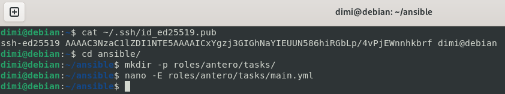

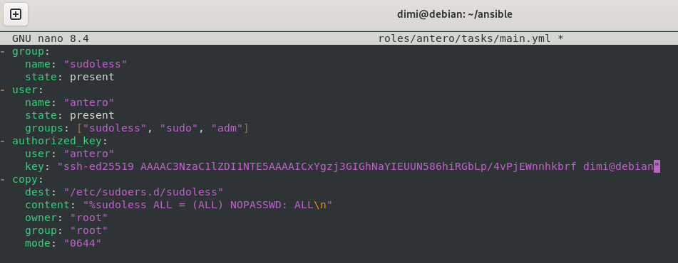


```
cat ~/.ssh/id_ed25519.pub

mkdir -p roles/antero/tasks/
nano -E roles/antero/tasks/main.yml
```

```
# main.yml tiedosto
- group:
    name: "sudoless"
    state: present
- user:
    name: "antero"
    state: present
    groups: ["sudoless", "sudo", "adm"]
- authorized_key:
    user: "antero"
    key: "ssh-ed25519 AAAAC3NzaC1lZDI1NTE5AAAAICxYgzj3GIGhNaYIEUUN586hiRGbLp/4vPjEWnnhkbrf dimi@debian"
- copy:
    dest: "/etc/sudoers.d/sudoless"
    content: "%sudoless ALL = (ALL) NOPASSWD: ALL\n"
    owner: "root"
    group: "root"
    mode: "0644"
```

#### Seuraavaksi lisäsin roolin `site.yml`-tiedostoon ja ajoin playbookin kahdesti.

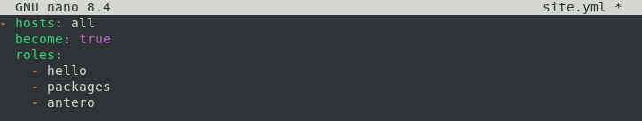

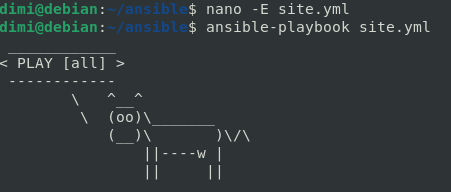

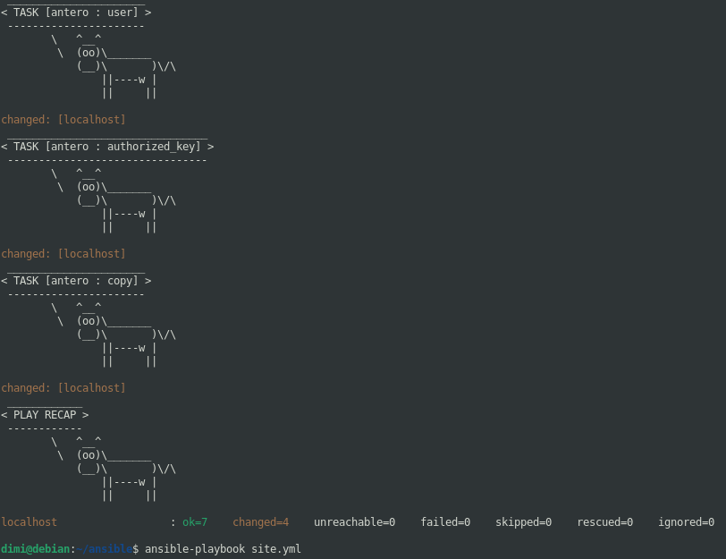

```
nano -E site.yml

ansible-playbook site.yml
```

#### Lopuksi testasin tuloksen. Otin `SSH`-yhteyden `antero`-käyttäjänä, ajoin `sudo whoami`, eikä salasanaa kysytty missään vaiheessa. Lisäksi `/etc/shadow`-tiedostossa anteron salasanakentässä on vain huutomerkki, eli tunnuksella ei ole salasanaa ja sisään pääsee vain avaimella.

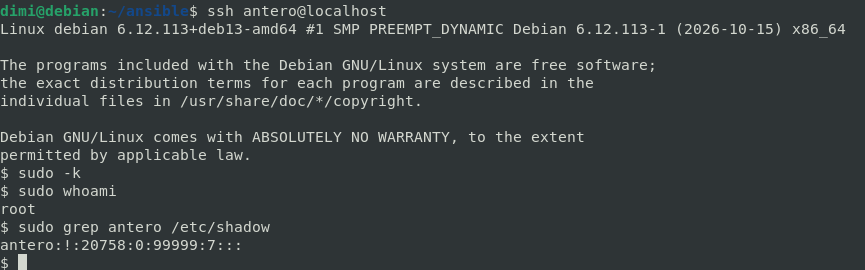

```
ssh antero@localhost
sudo -k
sudo whoami
sudo grep antero /etc/shadow
```

## c) Package

#### Päätin asentaa pari hauskaa ohjelmaa `fortune` ja `lolcat`, joita voi käyttää yhdessä h1 harjoituksessa asentaman `cowsayn` kanssa. Tämä on nyt siinä mielessä helppo homma, koska packages-rooli oli jo olemassa ja siihen riitti lisätä uudet paketit.

#### Lisäsin paketit `packages`-roolin listaan, sekä kaksi ominaisuutta Ansiblen dokumentaatiosta. `update_cache` päivittää pakettiluettelon ennen asennusta ja `cache_valid_time: 3600` skippaa päivityksen, jos luettelo on päivitetty viimeisen tunnin aikana.

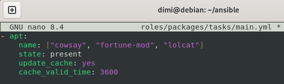

```
nano -E roles/packages/tasks/main.yml

# main.yml tiedosto
- apt:
    name: ["cowsay", "fortune-mod", "lolcat"]
    state: present
    update_cache: yes
    cache_valid_time: 3600
```

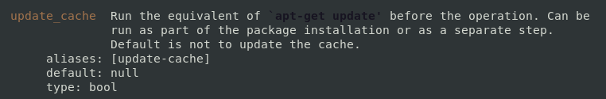

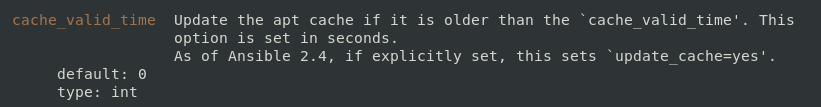

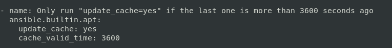

#### Lopuksi ajoin playbookin kahdesti ja testasin ohjelmat.

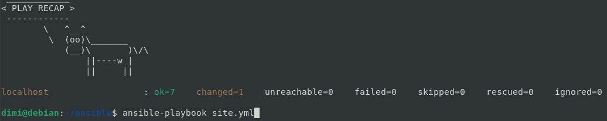

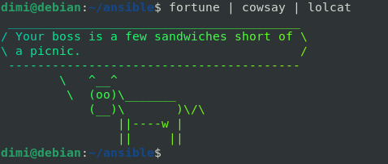

```
ansible-playbook site.yml

which fotune lolcat
fortune | cowsay | lolcat
ansible-playbook site.yml | lolcat -a
```

#### Tällä saa värikkäät ja animoidut Ansible-lehmät.

```
ansible-playbook site.yml | lolcat -a
```
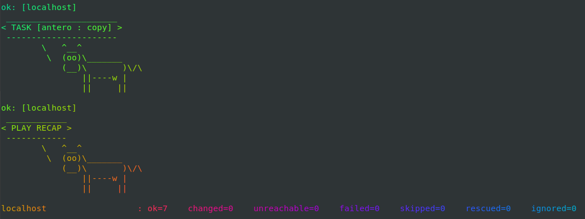

## d) File

#### Tässä harjoituksessa loin jälleen uudelle `cows`-roolille kansion ja tehtävätiedoston. Käytin tähän `copy`-moduulia, koska se kirjoittaa tiedoston sisällön ja asettaa samalla omistajan, ryhmän ja oikeudet. Käytin myös `YAML`:n `|`-merkkiä, joka säilyttää rivinvaihdot sellaisinaan useamman rivin tekstissä. Sitten lisäsin roolin playbookiin ja ajoin sen kahdesti.


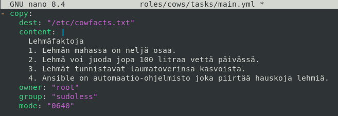

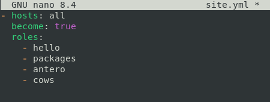

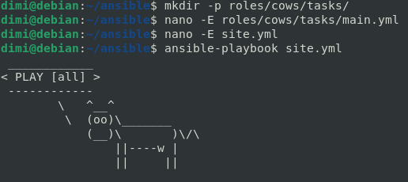

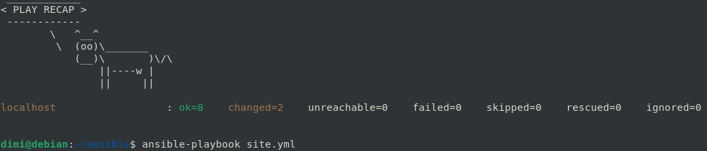

```
mkdir -p roles/cows/tasks/
nano -E roles/cows/tasks/main.yml

# main.yml tiedosto
- copy:
    dest: "/etc/cowfacts.txt"
    content: |
      Lehmäfaktoja
      1. Lehmän mahassa on neljä osaa.
      2. Lehmä voi juoda jopa 100 litraa vettä päivässä.
      3. Lehmät tunnistavat laumatoverinsa kasvoista.
      4. Ansible on automaatio-ohjelmisto joka piirtää hauskoja lehmiä.
    owner: "root"
    group: "sudoless"
    mode: "0640"

nano -E site.yml

ansible-playbook site.yml
```

#### Lopuksi testasin. Testauksen tulokset:
- tiedoston oikeudet ovat `0640` eli `rw-` omistajalla (`root`), `r--` ryhmällä (`sudoless`) ja `---` ei mitään muilla (esim. `dimi`-käyttäjällä). Oktaaliluvun ensimmäinen 0 tarkoittaa, ettei tiedostolla ole erikoisoikeuksia

| Oktaali | Symbolinen | Binääri | Oikeudet |
|---|---|---|---|
| 7 | `rwx` | 111 | luku, kirjoitus, suoritus |
| 6 | `rw-` | 110 | luku, kirjoitus |
| 5 | `r-x` | 101 | luku, suoritus |
| 4 | `r--` | 100 | luku |
| 3 | `-wx` | 011 | kirjoitus, suoritus |
| 2 | `-w-` | 010 | kirjoitus |
| 1 | `--x` | 001 | suoritus |
| 0 | `---` | 000 | ei mitään |

- siksi `dimi` sai `Permission denied`, kun yritti lukea tiedostoa
- `antero` kuuluu `sudoless`-ryhmään joten lukeminen onnistui ryhmän oikeuksilla
- `dimi` pystyi lukemaan tiedoston sudon avulla, koska silloin komento ajettiin `rootina` eli omistajana.
- `rootina` käyttäjät voisivat myös muuttaa tiedostoa

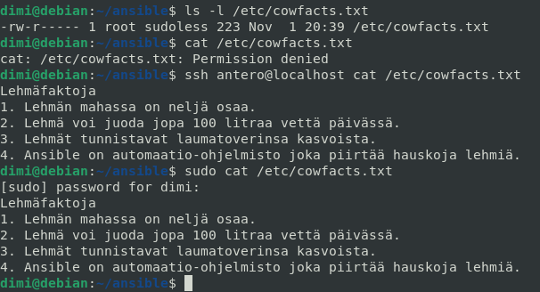

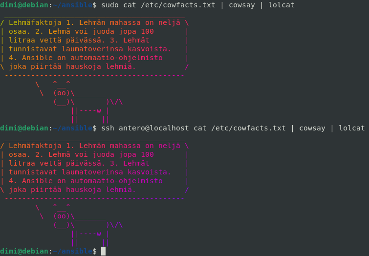

```
ls -l /etc/cowfacts.txt
cat /etc/cowfacts.txt
ssh antero@localhost cat /etc/cowfacts.txt
sudo cat /etc/cowfacts.txt

# meemikomennot
sudo cat /etc/cowfacts.txt | cowsay | lolcat
ssh antero@localhost cat /etc/cowfacts.txt | cowsay | lolcat
```

## e) Jotain muuta

#### Raportissa on jo tehty paljon erilaista, joten lisäsin tähän yhden mielestäni hyödyllisen ominaisuuden, jota kurssilla ei ole vielä käytetty `lookup`. Vaihdoin `antero`-roolissa käsin liitetyn julkisen avaimen tilalle `lookup` haun. Se lukee julkisen SSH-avaimen suoraan tiedostosta, eikä sitä tarvitse kopioida manuaalisesti. Ansible kirjoittaa avaimen hallittavalle koneelle automaatisesti.

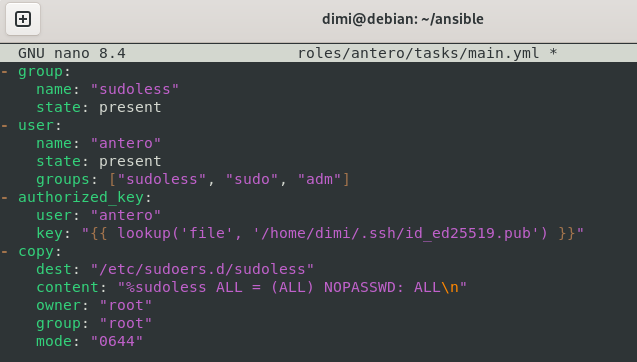

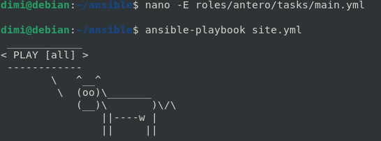

```
nano -E roles/antero/tasks/main.yml

# main.yml tiedosto
key: "{{ lookup('file', '/home/dimi/.ssh/id_ed25519.pub') }}"

ansible-playbook site.yml
```

#### Playbookin ajon jälkeen mikään ei muuttunut, koska lookupin hakema avain on käytännössä sama kun edellinen. Seuraavaksi siirsin `anteron` `authorized_keys`-tiedoston pois ja yritin kirjautua `anterona`. Kirjautuminen avaimella ei onnistunut ja SSH kysyi salasanaa, jota ei ole olemassakaan.

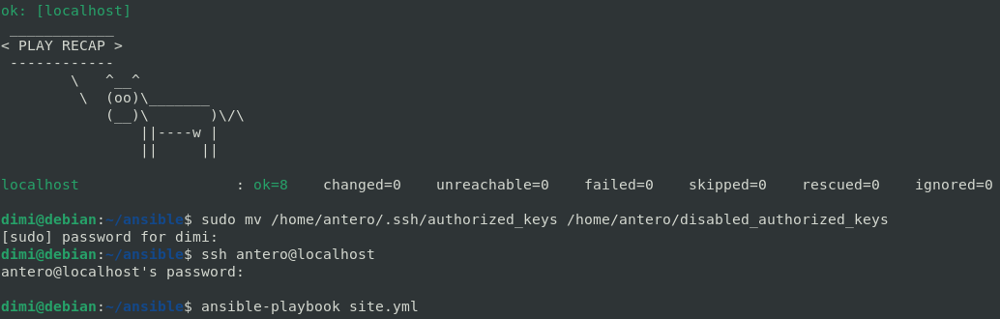

```
sudo mv /home/antero/.ssh/authorized_keys /home/antero/disabled_authorized_keys

ssh antero@localhost

ansible-playbook site.yml
```

#### Ajoin playbookin uudelleen, tuli yksi muutos, koska rooli palautti avaimen. Kirjautuminen `anterona` onnistui taas ilman salasanaa. Lopuksi poistin siirretyn avaintiedoston.

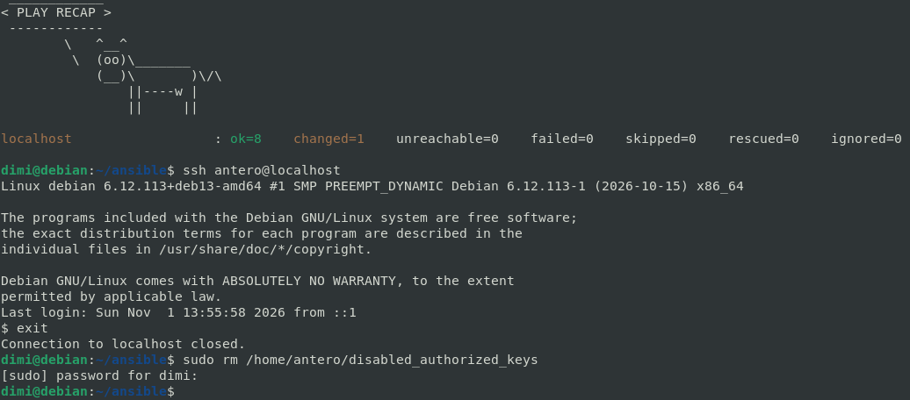

```
ssh antero@localhost

sduo rm /home/antero/disabled_authorized_keys
```

#### Tätä samaa tapaa voisi käyttää myös `ansible`-käyttäjälle, jonka avaimen kopioin a) kohdassa käsin. Avaimen voisi myös hakea GitHubista. En testannut sitä tässä, kunhan kerron, että se on mahdollista.

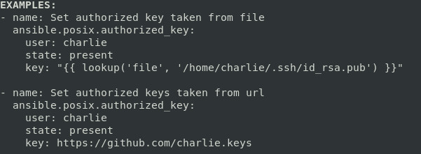
```
mkdir -p roles/key/tasks/
nano -E roles/key/tasks/main.yml

# lookup
- authorized_key:
    user: "ansible"
    key: "{{ lookup('file', '/home/dimi/.ssh/id_ed25519.pub') }}"

# GitHub
- authorized_key:
    user: "ansible"
    key: "https://github.com/dimi-viitakoski.keys"
```


#### Lopuksi vielä vähän pelleilyä lehmien kanssa.

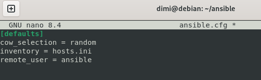

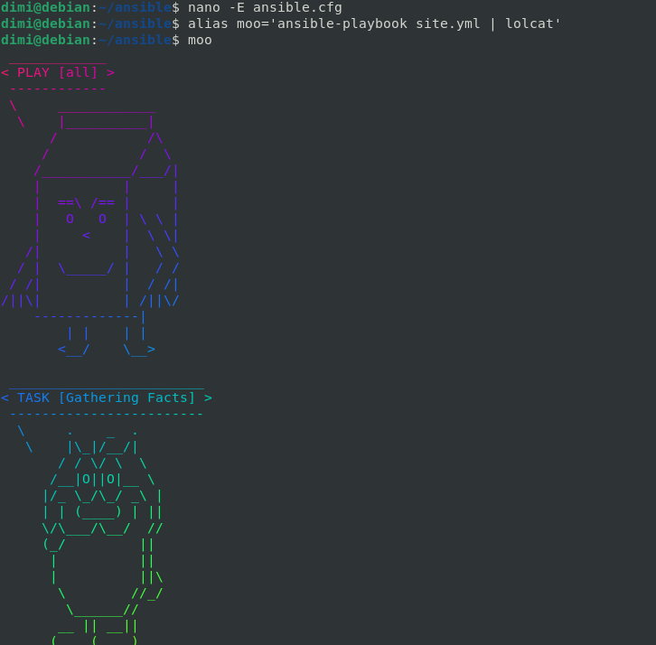

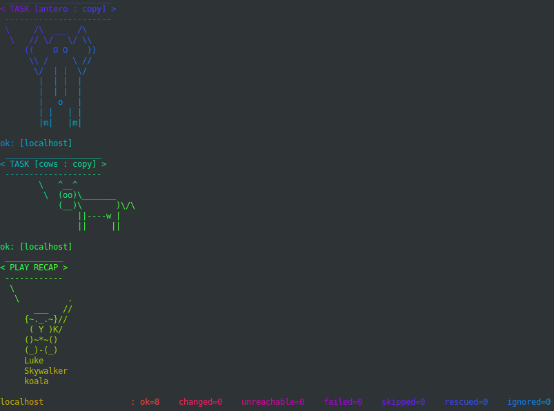

```
nano -E ansible.cfg

# ancible.cfg tiedosto
cow_selection = random

alias moo='ansible-playbook site.yml | lolcat'
```

## Teknisiä vaikeuksia

Minulla ei ollut tässä tehtävässä varsinaisia teknisiä vaikeuksia, vain yksi simppeli virhe, joka oli ratkaistu ja dokumentoitu aiemmin. Harjoitus oli aika pitkä ja on ollut aika paljon toistoa, joka on siis hyvä juttu. Sain harjoiteltua ainakin tarpeeksi, ehkä jopa muistankin jotain :)

## Lähteet:
[Karvinen 2026: Palvelinten Hallinta](https://terokarvinen.com/palvelinten-hallinta/)
