# h3 Demoni

## x) Lue ja tiivistä

### Artikkeli 1.

**Karvinen 2026: Apache installed with Ansible - quick notes**

Tämä artikkeli ei ollut varsinainen tutoriaali, vaan kokoelma keskeisistä asioista, joita tarvitaan Apache webbipalvelimen automaattiseen asennukseen Ansiblella.

- Demonit, kuten Apache, konfiguroidaan yleensä samalla tavalla. Tätä siis kutsutaan **package-file-service-malliksi**: ensin asennetaan paketti, sitten muokataan asetustiedostoja ja lopuksi käynnistetään palvelu uudelleen. Asetustiedostojen muutokset tulevat voimaan vasta, kun palvelu käynnistetään uudelleen. Siksi tiedostoja muuttavat tehtävät ilmoittavat (`notify`) handlerille, joka käynnistää Apachen uudelleen.
- Roolissa on kolme kansiota: `files/` sisältää tiedostojen alkuperäisversiot, `handlers/` palveluiden uudelleenkäynnistykset ja `tasks/` varsinaisen Ansible-koodin.
- Ensimmäisenä `apt` asentaa Apachen. Sitten `copy` kopioi sivuston asetustiedoston `files/`-kansiosta hakemistoon `/etc/apache2/sites-available/`. Lopuksi `file` tekee siitä linkin hakemistoon `sites-enabled/`, jolloin sivusto otetaan käyttöön.
- Asetustiedostossa `VirtualHost` on määritetty porttiin 80. Sen `DocumentRoot` osoittaa käyttäjän kotihakemistossa olevaan kansioon, ja `require all granted` sallii Apachen jakaa sen sisältöä. Tiedoston alussa oleva kommentti kertoo, että tiedostoa hallitaan Ansiblella ja käsin tehdyt muutokset korvataan.

**Keskeiset komennot**

```
sudo apt-get install apache2
sudoedit /etc/apache2/...
sudo systemctl restart apache2
```
```
# tasks/main.yml tiedosto

- apt:
    name: apache2
    state: present

- copy:
    dest: "/etc/apache2/sites-available/example.com.conf"
    src: "example.com.conf"
    owner: "root"
    group: "root"
    mode: "0644"
  notify: restart apache2

- file:
    src: /etc/apache2/sites-available/example.com.conf
    dest: /etc/apache2/sites-enabled/example.com.conf
    owner: root
    group: root
    state: link
  notify: restart apache2
```
```
# handlers/main.yml tiedosto

- name: restart apache2
  systemd:
    name: apache2
    state: restarted
```
```
# files/example.com.conf tiedosto

# Managed file, changes will be overwritten

<VirtualHost *:80>
        ServerName example.com
        DocumentRoot /home/tero/publicsite/

        <Directory /home/tero/publicsite/>
                require all granted
        </Directory>
</VirtualHost>
```

**Oma kysymys tai huomio**

Debian ottaa Apachen asennuksessa automaattisesti käyttöön oletussivuston `000-default`, mutta artikkelissa sitä ei poisteta käytöstä tai siitä ei ainakaan kerrota. Kumpi sivu näkyy `localhost`:ssa, kun molemmat sivustot kuuntelevat porttia 80?

**Lähteet**

[Karvinen 2026: Apache installed with Ansible - quick notes](https://terokarvinen.com/apache-ansible/)


### Ansible Community Documentation

**Handlers: running operations on change**

Handlerit ovat Ansiblen tehtäviä, jotka ajetaan vain silloin, kun jokin toinen tehtävä muuttaa koneella jotain ja ilmoittaa siitä niille. Tyypillinen esimerkki on palvelun uudelleenkäynnistys. Eli kun asetustiedosto muuttuu, palvelu käynnistetään uudelleen, mutta jos tiedosto pysyy ennallaan, uudelleenkäynnistystä ei tehdä.

- Tehtävä ilmoittaa handlerille `notify`-avainsanalla. Sille voi antaa yhden handlerin nimen tai listan nimistä, ja ilmoitus lähtee vain, kun tehtävä muuttaa jotain.
- Handlerit ajetaan siinä järjestyksessä, jossa ne on määritelty `handlers`-osiossa, eikä siinä järjestyksessä, jossa ne on lueteltu `notify`-kohdassa.
- Vaikka useampi tehtävä ilmoittaisi samalle handlerille, se ajetaan vain kerran. Jos esimerkiksi useat tehtävät muuttavat Apachen asetuksia, Apache käynnistetään uudelleen vain kerran.
- Oletuksena handlerit ajetaan vasta, kun kaikki tehtävät on suoritettu.

**Oma kysymys tai huomio**

Handler käynnistää palvelun uudelleen heti, kun asetustiedosto muuttuu. Mitä jos uudessa asetustiedostossa on virhe?

**Lähteet**

[Ansible Community Documentation: Handlers: running operations on change](https://docs.ansible.com/projects/ansible/latest/playbook_guide/playbooks_handlers.html)


### Ansiblen sisäänrakennettu dokumentaatio

**service:** hallitsee palveluita asiakaskoneella. Eli käynnistää, pysäyttää sekä asettaa palveluita käynnistymään automaattisesti bootissa. Moduuli toimii eri Linux-jakeluissa, koska se käyttää koneen omaa palvelunhallintaa, kuten `systemd`:tä.

- `enabled`: käynnistyykö palvelu automaattisesti koneen käynnistyessä. 
- `name`: palvelun nimi, pakollinen
- `state`: palvelun haluttu tila. `started` ja `stopped` ajavat komennon vain tarvittaessa, `restarted` käynnistää palvelun aina uudelleen ja `reloaded` lataa aina asetukset uudelleen.
- Tässä on oltava ainakin `state` tai `enabled`, muuten sillä ei olisi mitään tehtävää.

Esimerkki käynnistää httpd-palvelun jos se ei ole jo käynnissä.

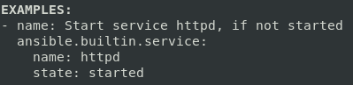


**Oma kysymys tai huomio**

`started` ja `stopped` ovat idempotentteja, mutta `restarted` käynnistää palvelun aina uudelleen. Sitä varmaan kannattaa käyttää handlerissa eikä tavallisena tehtävänä, ettei palvelu käynnisty turhaan joka ajolla.

**Lähteet**

```
ansible-doc service
```

## a) Apassi

#### Apache asennettiin jo [h0 f) Vaihtoehtotehtävä](../h0/h0.md#f-vaihtoehtotehtava). Joten tässä tarkistan vaan, että se on käynissä.

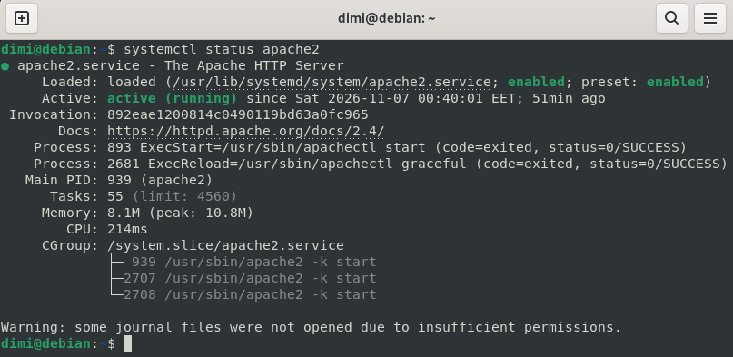

```
systemctl status apache2
```

#### Seuraavaksi loin kansion julkisille sivuille ja sinne etusivun. Annoin kansioille `x`-oikeuden ja tiedostolle `r`-oikeuden, jotta Apache (`www-data`) pääsee lukemaan sivun. Lopuksi tarkistin oikeudet.

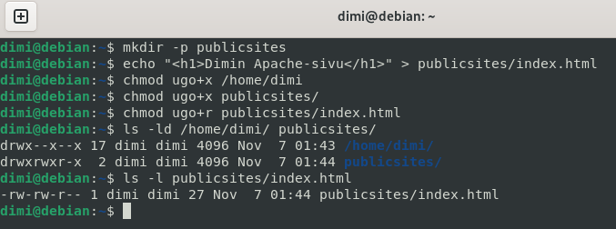

```
mkdir -p publicsites
echo "<h1>Dimin Apache-sivu</h1>" > publicsites/index.html

chmod ugo+x /home/dimi
chmod ugo+x publicsites
chmod ugo+r publicsites/index.html

ls -ld /home/dimi publicsites
ls -l publicsites/index.html
```

#### Seuraavaksi konfiguroin sivuston. Loin uuden konfiguraatiotiedoston jossa `DocumentRoot` osoittaa oikean kansioon ja `Require all granted` sallii Apachen jakaa sen sisältöä. Ilman sitä Apache estää oletuksena kaikki kansiot hakemiston `/var/www` ulkopuolella. 

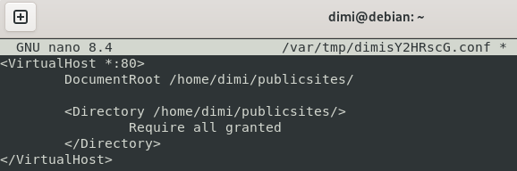

```
sudoedit /etc/apache2/sites-available/dimi.conf

# dimi.conf tiedosto
<VirtualHost *:80>
        DocumentRoot /home/dimi/publicsites/

        <Directory /home/dimi/publicsites/>
                Require all granted
        </Directory>
</VirtualHost>
```

#### Poistin oletussivun käytöstä, otin oman sivun käyttöön ja testasin konfiguraation syntaksin (`AH00558`-varoitus johtuu puuttuvasta `ServerName`-asetuksesta, mutta se ei vaikuta paikalliseen sivuun). Sitten käynnistin Apachen uudelleen.

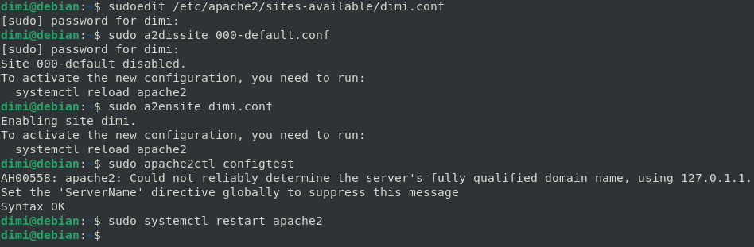

```
sudo a2dissite 000-default.conf
sudo a2ensite dimi.conf
sudo apache2ctl configtest
sudo systemctl restart apache2
```

#### Lopuksi testasin, että sivua voi muokata ilman sudoa.

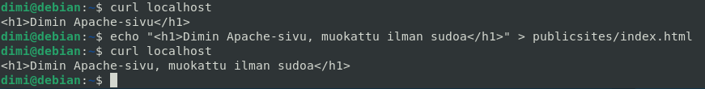

```
curl localhost
echo "<h1>Muokattu ilman sudoa</h1>" > publicsites/index.html
curl localhost
```

## b) Moottorix

#### Ensin poistin Apachen käytöstä, koska kaksi demonia ei voi kuunnella samaa porttia. Sitten asensin Nginxin ja tarkistin sen tilan.

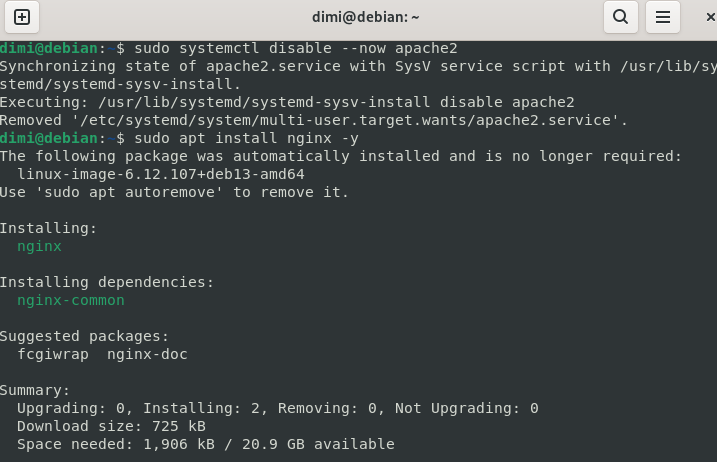

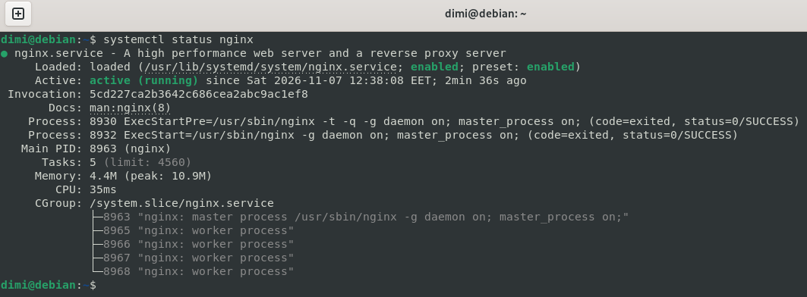

```
sudo systemctl disable --now apache2

sudo apt install nginx -y
systemctl status nginx
```

#### Seuraavaksi konfiguroin sivuston. Käytin samaa kansiota kuin Apachen kanssa, koska Nginx toimii myös käyttäjänä `www-data` ja oikeudet olivat jo kunnossa. Nginxin konfiguraatio on yksinkertaisempi, koska `<Directory>`-osiota ei tarvita. `a2ensite`-komennon sijaan poistin oletussivuston linkin ja tein oman linkin `ln -s` -komennolla. Sitten testasin syntaksin ja käynnistin Nginxin uudelleen.

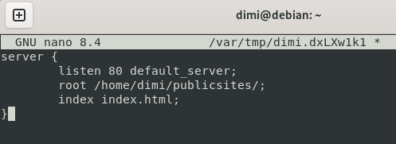

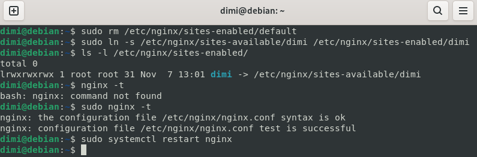

```
sudoedit /etc/nginx/sites-available/dimi

# dimi tiedosto
server {
        listen 80 default_server;
        root /home/dimi/publicsites/;
        index index.html;
}

sudo rm /etc/nginx/sites-enabled/default
sudo ln -s /etc/nginx/sites-available/dimi /etc/nginx/sites-enabled/dimi
ls -l /etc/nginx/sites-enabled/

sudo nginx -t
sudo systemctl restart nginx
```

#### Lopuksi testasin. `curl -I` näytti, että sivun tarjoaa nyt Nginx, vaikka tiedosto oli sama kuin Apachella. Sitten muokkasin sivua ilman sudoa.

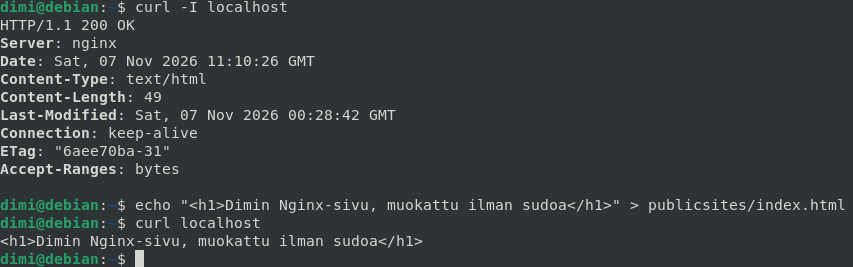

```
curl -I localhost
echo "<h1>Dimin Nginx-sivu, muokattu ilman sudoa</h1>" > publicsites/index.html
curl localhost
```

## c) Automoottorix

#### Ensin poistin asennetun Nginx, jotta Ansiblen tekemiä muutoksia näkyvät järkevämmin.

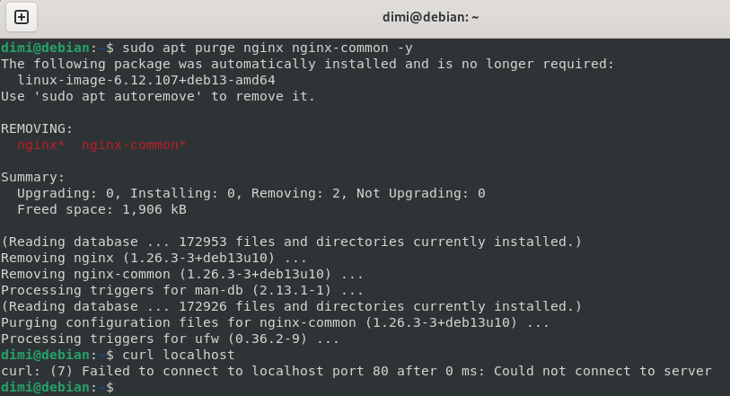

```
sudo apt purge nginx nginx-common -y 
curl localhost
```

#### Seuraavaksi loin nginx-roolille hakemistorakenteen, eli `tasks/`-kansioon tulee varsinainen koodi, `handlers/`-kansioon palvelun uudelleenkäynnistys ja `files/`-kansioon konfiguraatiotiedoston alkuperäisversio.

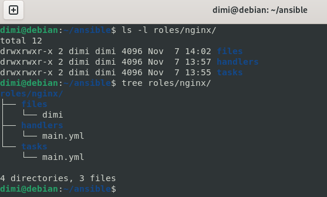

```
cd ansible
mkdir -p roles/nginx/tasks roles/nginx/handlers roles/nginx/files

ls -l roles/nginx
```

#### Loin konfiguraatiotiedoston. Sisältö on muuten sama kuin b-kohdassa. Alkuun lisäsin kommentin, että tiedostoa hallitaan Ansiblella.

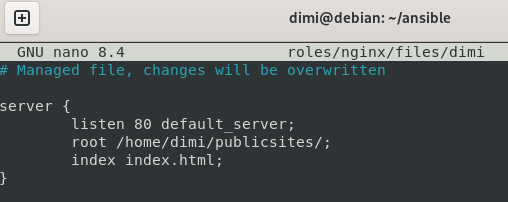

```
nano roles/nginx/files/dimi

# files/dimi tiedosto

# Managed file, manual changes will be overwritten

server {
        listen 80 default_server;
        root /home/dimi/publicsites/;
        index index.html;
}
```

#### Sitten loin tehtävät. `apt` asentaa Nginxin, `copy` kopioi konfiguraatiotiedoston hakemistoon `sites-available/`, ensimmäinen `file`-tehtävä tekee linkin hakemistoon `sites-enabled/` (sama kuin `ln -s` b-kohdassa) ja toinen poistaa oletussivuston linkin (sama kuin `rm` b-kohdassa). Nämä kolme tehtävää ilmoittavat (`notify`) handlerille, jos ne muuttavat jotain. `service` varmistaa, että Nginx on käynnissä ja käynnistyy koneen käynnistyessä.

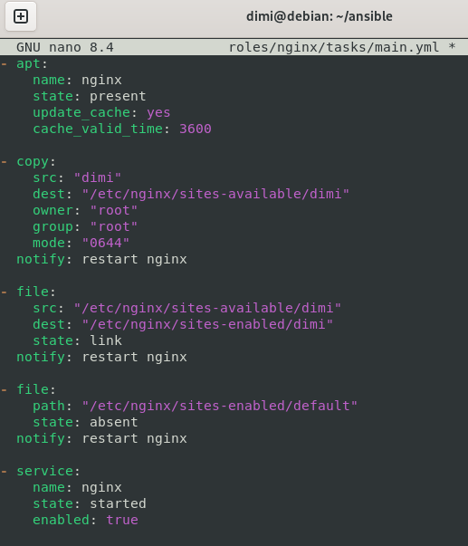

```
nano -E roles/nginx/tasks/main.yml

# tasks/main.yml tiedosto

- apt:
    name: nginx
    state: present
    update_cache: yes
    cache_valid_time: 3600

- copy:
    src: "dimi"
    dest: "/etc/nginx/sites-available/dimi"
    owner: "root"
    group: "root"
    mode: "0644"
  notify: restart nginx

- file:
    src: "/etc/nginx/sites-available/dimi"
    dest: "/etc/nginx/sites-enabled/dimi"
    state: link
  notify: restart nginx

- file:
    path: "/etc/nginx/sites-enabled/default"
    state: absent
  notify: restart nginx

- service:
    name: nginx
    state: started
    enabled: true
```

#### Loin handlerin, joka käynnistää Nginxin uudelleen. Handlerin nimen pitää olla täsmälleen sama kuin tehtävien `notify`-kohdassa.

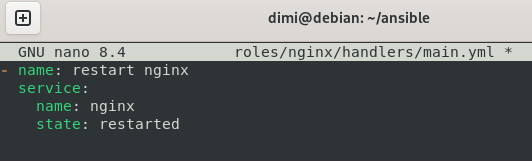

```
nano -E roles/nginx/handlers/main.yml

# handlers/main.yml tiedosto

- name: restart nginx
  service:
    name: nginx
    state: restarted
```

#### Viimeisenä lisäsin roolin `site.yml`-tiedostoon.

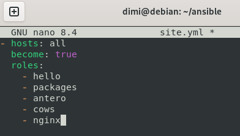

```
nano -E site.yml

# site.yml tiedosto

- hosts: all
  become: true
  roles:
    - hello
    - packages
    - antero
    - cows
    - nginx
```

#### Sitten ajoin playbookin kahdesti ja testasin sivun.

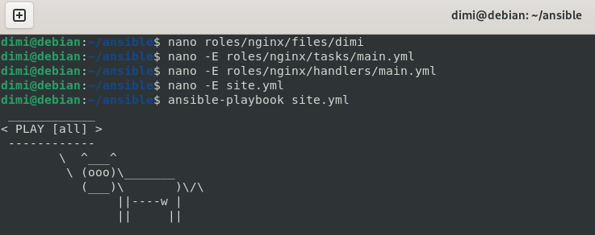

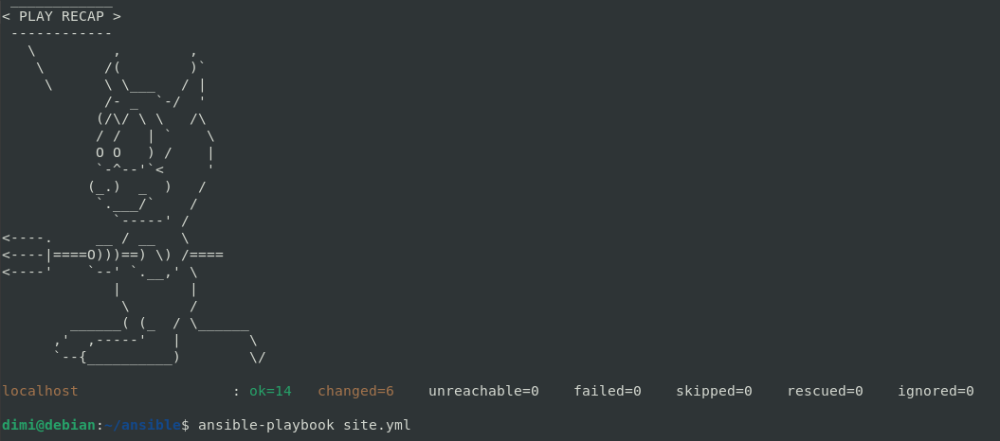

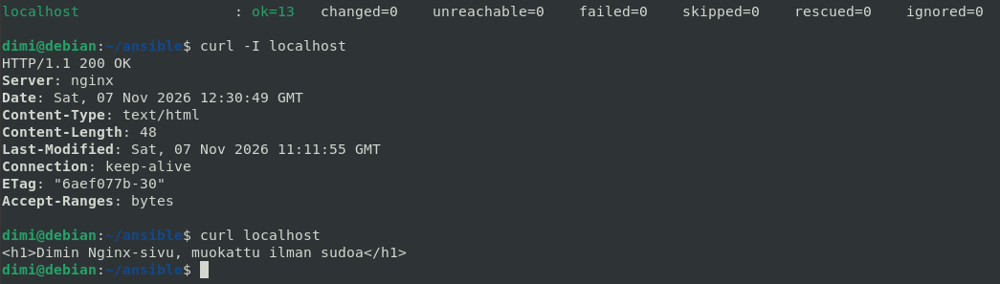

```
ansible-playbook site.yml

curl -I localhost
curl localhost
```

## d) Vapaaehtoinen bonus

#### Tutkin [Osiris-T](https://github.com/oskarihakamies/IDS-project) ohjelmistoa ja vaikutti vielä keskeneräiseltä, sekä vaati aika paljon tehoa koneelta. Päätin etten asenna sitä, haluaisin kuitenkin testata vielä jotain. Niin, päätin asentaa Osiris-T:n ydinosan Suricatan. Se on siis IDS joka tarkkailee verkkoliikennettä ja hälyttää, kun liikenne vastaa jotain tunnettua hyökkäyksen tunnistetta. Silloin kun kirjoitin tämän olin vielä siinä uskossa, että säästän tällä tempulla aikaa, enkä joudu debugata mitään 😅


#### Ensin tarkistin verkkokortin nimen (`enp0s3`) ja asensin Suricatan manuaalisesti.

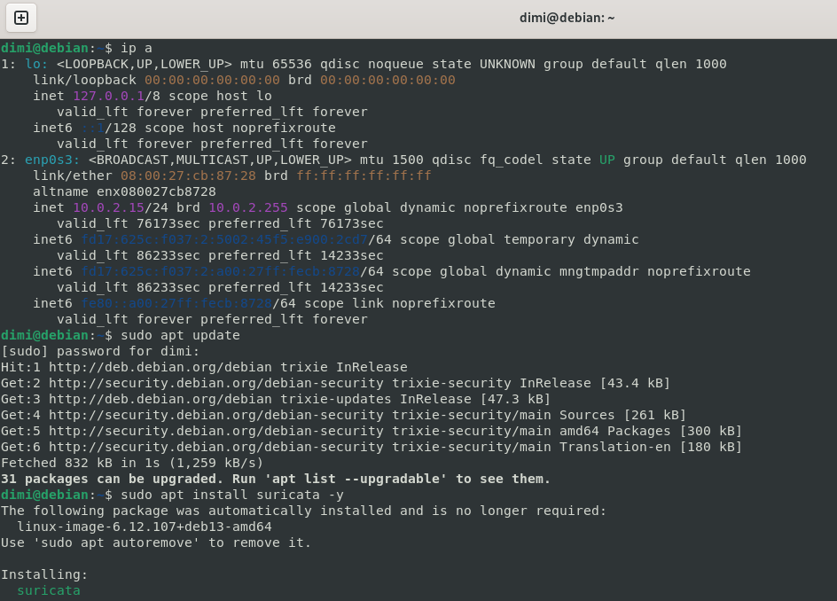

```
ip a

sudo apt update
sudo apt install suricata -y
```

#### Debianin oletusasetuksissa Suricata kuuntelee verkkokorttia `eth0`. Vaihdoin `af-packet`-osioon oikean verkkokortin.

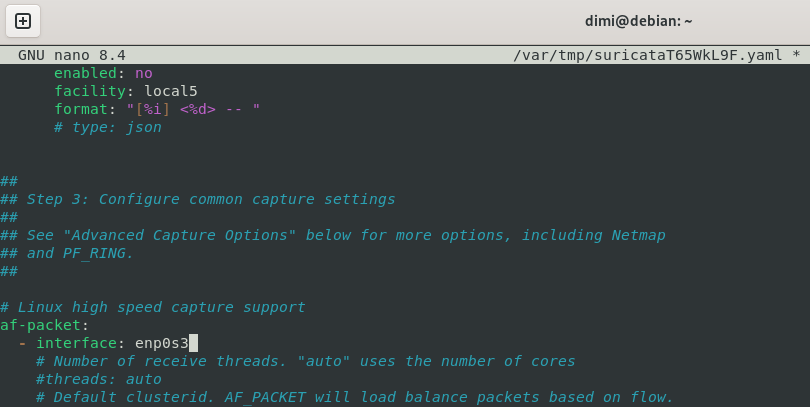

```
sudoedit /etc/suricata/suricata.yaml

# muutettu rivi

af-packet:
  - interface: enp0s3
```

#### Seuraavaksi latasin `suricata-update`-komennolla ET Open -säännöt, eli noin 69 000 tunnettua hyökkäyksen tunnistetta.

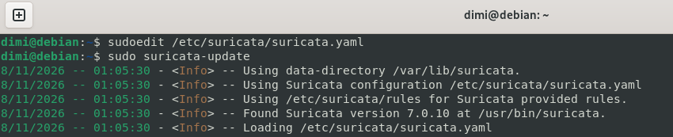

```
sudo suricata-update
```

#### Testasin konfiguraation, käynnistin Suricatan uudelleen ja tarkistin, että se on käynnissä.

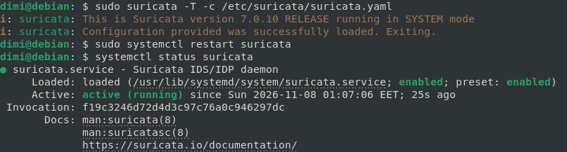

```
sudo suricata -T -c /etc/suricata/suricata.yaml
sudo systemctl restart suricata
systemctl status suricata
```

#### Lopuksi testasin hälytystä. Käytin testinä hienon ohjelman `BlackSun` user-agentia. Pyyntö itsessään on harmiton, mutta Suricata tunnisti sen ja kirjasi hälytyksen `fast.log`-tiedostoon.

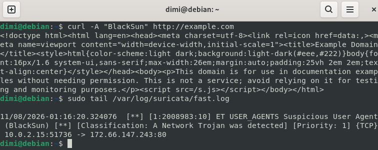

```
curl -A "BlackSun" http://example.com
sudo tail /var/log/suricata/fast.log
```

#### Seuraavaksi yritin automatisoida saman Ansiblella. Poistin asennetun Suricatan ja ladatut säännöt.

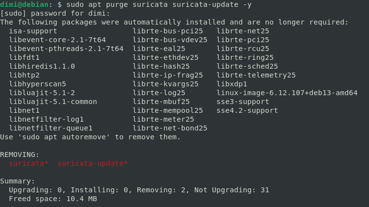

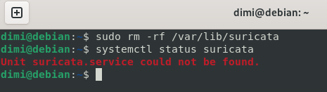

```
sudo apt purge suricata suricata-update -y
sudo rm -rf /var/lib/suricata

systemctl status suricata
```

#### Loin suricata-roolin hakemistorakenteen ja tiedostot. `apt` asentaa paketit, `lineinfile` olisi pitänyt vaihtaa verkkokortti onnistuneesti, `command` lataa säännöt (`creates` estää lataamisen, jos säännöt ovat jo olemassa) ja `service` pitää Suricatan käynnissä. Muutokset ilmoittavat handlerille, joka käynnistää Suricatan uudelleen.

#### En käyttänyt `copy`-moduulia, koska suricatan asetustiedostostossa on yli 2000 riviä, josta piti muuttaa vain yksi. `lineinfile` muokkaa tiedostosta yhtä riviä koskematta muuhun sisältöön, mutta hakulausekkeen pitää osua sekä ennen muutosta (`eth0`) että muutoksen jälkeen (`enp0s3`). Jos hakulauseke osuu useaan riviin, se muuttaa oletuksena viimeisen osuman. Tietenkin minulla se muutti väärän rivin, kun tiedostossa oli kaksi täsmälleen samanlaista riviä.

- `path`: muokattava tiedosto
- `regexp`: hakulauseke, jolla etsitään muutettava rivi
- `line`: rivi, joka laitetaan löydetyn rivin tilalle 

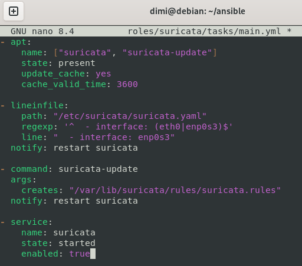

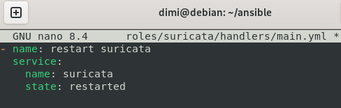

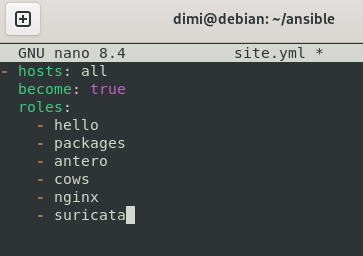

```
mkdir -p roles/suricata/tasks roles/suricata/handlers
```

```
nano -E roles/suricata/tasks/main.yml

# tasks/main.yml tiedosto

- apt:
    name: ["suricata", "suricata-update"]
    state: present
    update_cache: yes
    cache_valid_time: 3600

- lineinfile:
    path: "/etc/suricata/suricata.yaml"
    regexp: '^  - interface: (eth0|enp0s3)$'
    line: "  - interface: enp0s3"
  notify: restart suricata

- command: suricata-update
  args:
    creates: "/var/lib/suricata/rules/suricata.rules"
  notify: restart suricata

- service:
    name: suricata
    state: started
    enabled: true
```

```
nano -E roles/suricata/handlers/main.yml

# handlers/main.yml tiedosto

- name: restart suricata
  service:
    name: suricata
    state: restarted
```

```
nano -E site.yml

# site.yml tiedosto

- name: restart suricata
  service:
    name: suricata
    state: restarted
```

#### Ajoin playbookin kahdesti. Muutokset menivät läpi. Mutta testi epäonnistui. Suricata tulosti vanhan hälytyksen, mutta ei uutta.

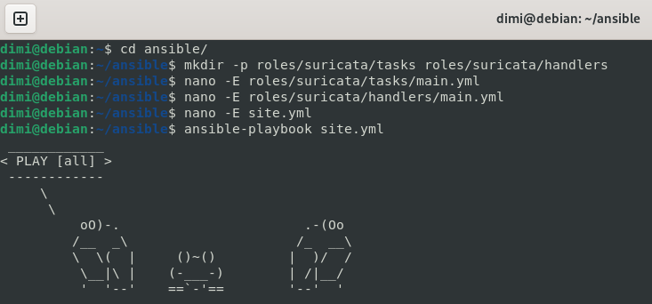

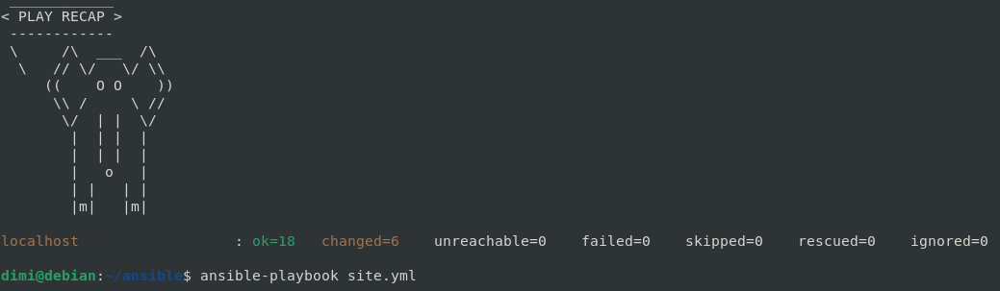

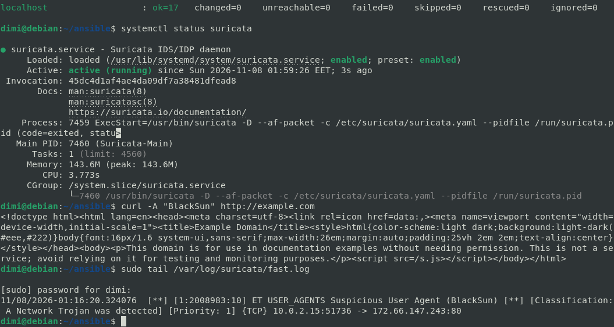

```
ansible-playbook site.yml

curl -A "BlackSun" http://example.com
sudo tail /var/log/suricata/fast.log
```

#### Lähdin tutkimaan vikaa. `lineinfile` on siis toiminut ja muokkaasi rivin 2026. Säännöt olivat myös olemassa. Lopulta selvisi että Suricata yritti yhä kuunnella verkkokorttia `eth0`. Asetustiedostossa on kaksi samanlaista riviä `  - interface: eth0`, toinen `af-packet`-osiossa (rivi 622) ja toinen `pcap`-osiossa (rivi 2026). `lineinfile` muutti oletuksena viimeisen osuman eli väärän rivin.

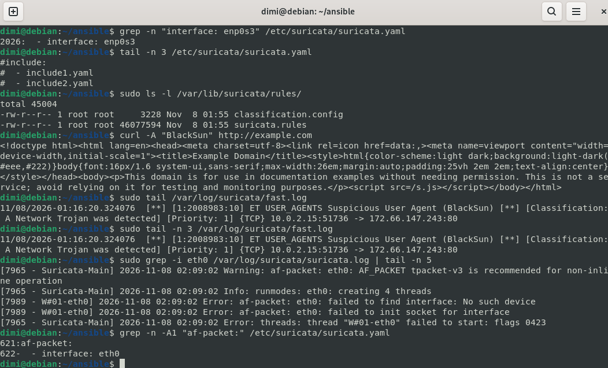

```
grep -n "interface: enp0s3" /etc/suricata/suricata.yaml
sudo ls -l /var/lib/suricata/rules/
sudo grep -i eth0 /var/log/suricata/suricata.log | tail -n 5
grep -n -A1 "af-packet:" /etc/suricata/suricata.yaml
```

#### Tutkin lisää ja korjasin koko homman `replace`-moduulilla, jonka hakulauseke kattaa kaksi riviä. Se muuttaa vain sen rivin, joka on suoraan `af-packet:`-rivin alla.

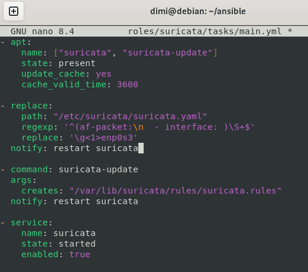

```
nano -E roles/suricata/tasks/main.yml

# tasks/main.yml tiedosto

- apt:
    name: ["suricata", "suricata-update"]
    state: present
    update_cache: yes
    cache_valid_time: 3600

- replace:
    path: "/etc/suricata/suricata.yaml"
    regexp: '^(af-packet:\n  - interface: )\S+$'
    replace: '\g<1>enp0s3'
  notify: restart suricata

- command: suricata-update
  args:
    creates: "/var/lib/suricata/rules/suricata.rules"
  notify: restart suricata

- service:
    name: suricata
    state: started
    enabled: true
```

#### Jälleen kerran poistin Suricatan ja ajoin playbookin kahdesti. Tällä kertaa oikea rivi muuttui ja testi antoi uuden BlackSun-hälytyksen.

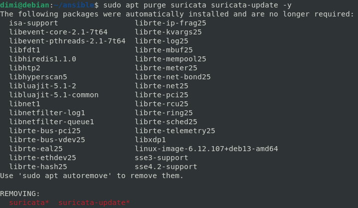

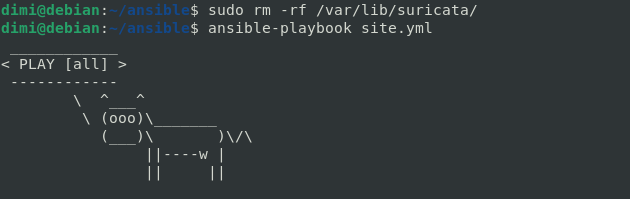

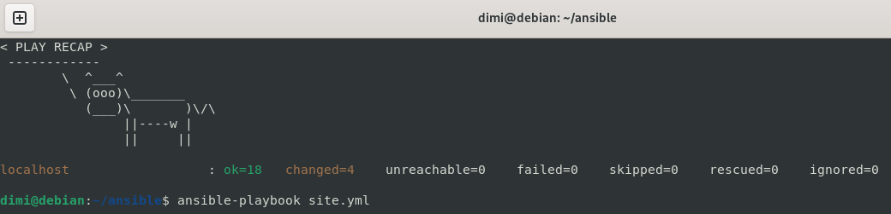

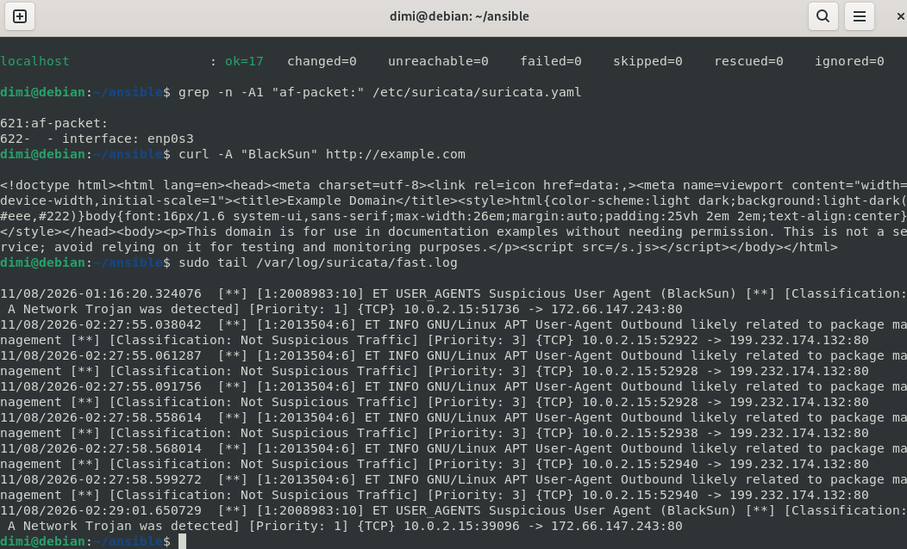

```
sudo apt purge suricata suricata-update -y
sudo rm -rf /var/lib/suricata/


ansible-playbook site.yml

grep -n -A1 "af-packet:" /etc/suricata/suricata.yaml

curl -A "BlackSun" http://example.com
sudo tail /var/log/suricata/fast.log
```

## Teknisiä vaikeuksia

Siinä varsinaisessa tehtävässä ei ollut teknisiä vaikeuksia. Mutta sitten vapaaehtoisessa tai "omassa" jouduin hetken miettiä ja tutkia miten nuo moduulit oikein toimii.

## Lähteet:

[Karvinen 2026: Palvelinten Hallinta](https://terokarvinen.com/palvelinten-hallinta/)

[Osiris-T](https://github.com/oskarihakamies/IDS-project)

[Suricata User Guide](https://docs.suricata.io/en/suricata-8.0.8/quickstart.html#)

[Suricata Rules](https://docs.suricata.io/en/latest/rules/intro.html)

[Ansible lineinfile module](https://docs.ansible.com/projects/ansible/latest/collections/ansible/builtin/lineinfile_module.html)

[Ansible command module](https://docs.ansible.com/projects/ansible/latest/collections/ansible/builtin/command_module.html)

[Ansible replace module](https://docs.ansible.com/projects/ansible/latest/collections/ansible/builtin/replace_module.html)
