# h4 Pizza Fantasia

## x) Lue ja tiivistä

Tässä tehtävässä luettiin kolme kohtaa Teron väitöskirjasta. Ne käsittelevät konfiguraationhallintatyökalujen omia kieliä (DSL). Käytännössä kuinka laajoja ne ovat, mitä niistä oikeasti käytetään ja mistä perusosista konfiguraatio lopulta rakentuu.

**4.12.1 Size and Complexity of Some DSLs (112. Ominaisuuksien määrä.)**

- Konfiguraationhallintatyökalujen kielet voivat kasvaa todella laajoiksi ja monimutkaisiksi. Tero vertaili kahta työkalua Saltia ja Puppetia.
- Saltissa on yli 500 funktiota ja niiden dokumentaatio on tosi pitkä. Lisäksi Salt hoitaa ehtolauseet ja silmukat erillisillä mallipohjilla (Jinja2), mikä tuo ylläpitäjälle yhden kerroksen lisää opeteltavaa.
- Puppetissa funktioita on vähemmän, noin sata, mutta sen rakenteet poikkeavat tavallisista ohjelmointikielistä ja moniin asioihin on omat erikoiskäsitteensä.
- Molemmissa siis riittää opeteltavaa ja kieli voi monimutkaistua, vaikka varsinainen tehtävä olisi yksinkertainen.

**Oma kysymys tai huomio**

Yleisellä tasolla kuulostaa vähän masentavalta. Työkalun opettelu voi olla isompi urakka kuin se tehtävä. Voisiko tässä hyödyntää kielimalleja eräänlaisena välikerroksena, joka kääntää ylläpitäjän tavoitteen työkalun omalle kielelle ja vähentää näin turhaa monimutkaisuutta? Toisaalta ylläpitäjän pitäisi silti ymmärtää, mitä malli tuottaa, ennen kuin sen ajaa koneille.

**4.12.2 Use of DSL Functions in Case Configuration (112-115. Mitä oikeasti käytetään.)**

- Tässä Tero halusi selvittää, mitä funktioita oikeissa tuotantoympäristöissä oikeasti käytetään. Hän tutki kahta julkista Puppet-konfiguraatiota: Mozillan ja Yhdysvaltain hallinnon perusasetukset.
- Molemmissa käytetyimmät olivat about samat perusfunktiot. Vaikka työkaluissa on satoja funktioita, pieni joukko perusfunktioita hoitaa suurimman osan oikeasta työstä. Tämä vastaa myös Teron kokemuksia Puppet- ja Salt-kursseilta.

**Oma kysymys tai huomio**

Eli kaikkea ei tarvitse osata, kun muutamalla perusfunktiolla pääsee jo pitkälle.

**4.12.3.1 Dependencies Between Main Functions (115-117. Tärkeimmät rakennuspalikat.)**

- Tässä kohdassa Tero tarkastelee, mitkä ovat konfiguraationhallinnan tärkeimmät perusfunktiot ja miten ne rakentuvat toistensa päälle.
- Suurin osa työstä hoituu muutamalla funktiolla: demonit asennetaan package-file-service-mallilla, sovellukset package-file-mallilla, käyttäjiä hallitaan user- ja group-funktioilla ja tiedostoja file-funktiolla.
- Järjestelmän pitää olla idempotentti eli muutos tehdään vain jos kone ei ole jo halutussa tilassa. Tämä onnistuu yksinkertaisilla tarkistuksilla.
- Pohjimmiltaan vain kaksi asiaa vaikuttaa suoraan koneen tilaan: komentojen ajaminen ja tiedostojen käsittely. Kaikki muut funktiot voidaan rakentaa näiden kahden päälle.
- Koska ylläpitäjä tekee asiat yleensä ensin manuaalisesti ja vasta sitten automatisoi, hän luultavasti osaa jo yhdistellä näitä perusosia. Joten Tero kyseenalaistaa, kannattaako niiden päälle rakentaa paljon monimutkaisempia kerroksia.

**Oma kysymys tai huomio**

Teron loppukysymys osuu hyvin minun aiempaan pohdintaan. Jos oletetaan, että ylläpitäjä osaa jo ja ymmärtää nuo hommat ja jokainen abstraktiokerros lisää hänen kuormaansa, olisiko kielimallikin vain yksi kerros lisää? Vai olisiko se ensimmäinen kerros, joka oikeasti vähentää turhaa monimutkaisuutta sen sijaan, että lisäisi sitä?


**Lähteet**

[Karvinen 2023: Configuration Management of Distributed Systems over Unreliable and Hostile Networks](https://terokarvinen.com/palvelinten-hallinta/Karvinen-2023-Configuration-Management-of-Distributed-Systems-over-Unreliable-and-Hostile-Networks.pdf)


## a) Räpylä

#### Päätin asentaa darkstatin. Se on erittäin kevyt verkkoliikenteen analysaattori, joka seuraa yhden verkkokortin liikennettä ja näyttää mihin osoitteisiin kone on yhteydessä ja kuinka paljon dataa liikkuu (omalla nettisivulla). Se ei tallenna pakettien sisältöä, vaan laskee tavuja koneittain ja porteittain.

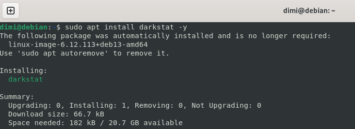

```
sudo apt install darkstat -y
```

#### Tarkistin verkkokortin nimen ja muokkasin asetustiedostoa. Oletuksena darkstat kuuntelee verkkokorttia `eth0`, joten vaihdoin tilalle `enp0s3`. Lisäksi sidoin nettisivun vain localhostiin (`BINDIP="-b 127.0.0.1"`), koska sivulla ei ole kirjautumista. `systemctl cat` näytti, että palvelu lukee asetukset tästä tiedostosta (`EnvironmentFile`). `START_DARKSTAT`-asetusta systemd ei kuitenkaan käytä, vaan palvelu otetaan käyttöön `systemctl enable` -komennolla.

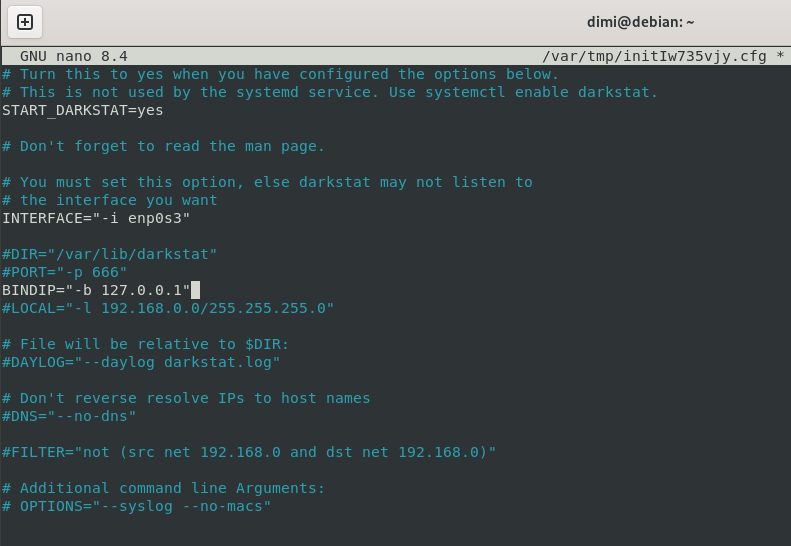

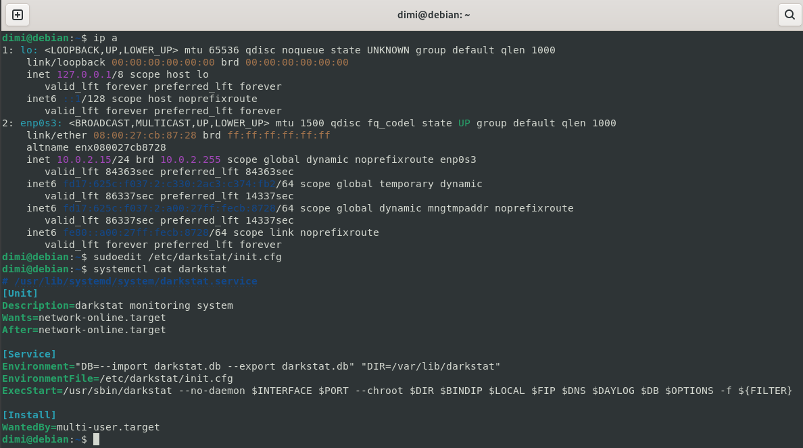

```
ip a
sudoedit /etc/darkstat/init.cfg

# /etc/darkstat/init.cfg tiedosto (muutetut rivit)
START_DARKSTAT=yes
INTERFACE="-i enp0s3"
BINDIP="-b 127.0.0.1"

systemctl cat darkstat
```

#### Otin palvelun käyttöön, käynnistin sen uudelleen, jotta asetukset tulisivat voimaan ja tarkistin. `ss -tlnp` näyttää mitkä TCP-portit ovat koneella auki ja mikä prosessi kuuntelee kutakin porttia (`-t` TCP, `-l` kuuntelevat, `-n` numerot ilman nimiä, `-p` mikä prosessi kuuntelee). Darkstat oli osoitteessa `127.0.0.1:667`. `ps -o user,args -C darkstat` näyttää darkstat-nimiset prosessit sekä niiden käyttäjän ja komentoriviargumentit. Argumenteissa näkyy asetukset ja prosessi toimi käyttäjänä `nobody` eikä rootina.

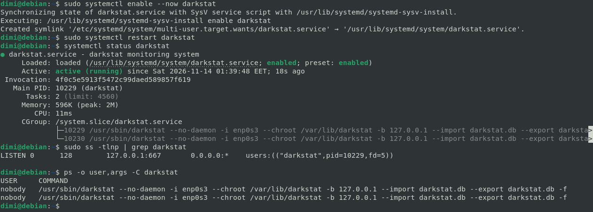

```
sudo systemctl enable --now darkstat
sudo systemctl restart darkstat
systemctl status darkstat

sudo ss -tlnp | grep darkstat
ps -o user,args -C darkstat
```


#### Lopuksi testasin. Ensiksi tein vähän verkkoliikennettä `curl`-komennolla. `-s` piilottaa curlin tilaviestit ja `> /dev/null` heittää ladatun sivun pois. Sen jälkeen hain darkstatin sivun komentorivillä ja selaimella.

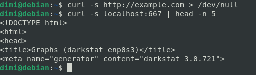

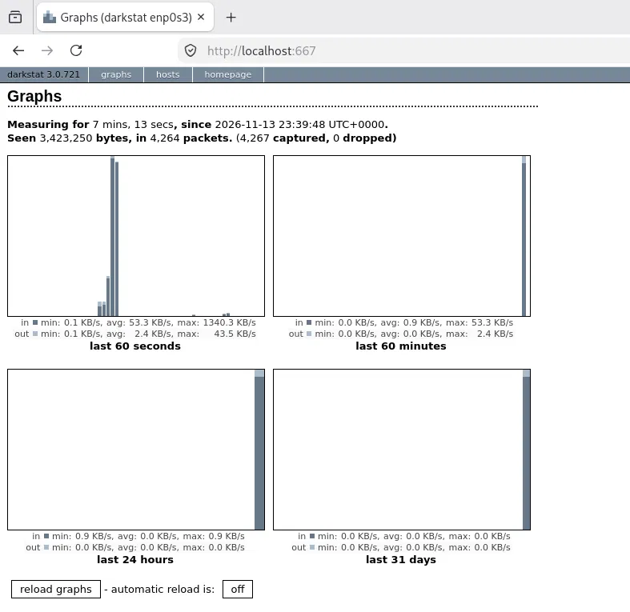

```
curl -s http://example.com > /dev/null
curl -s localhost:667 | head -n 5

# nettisivu selaimella 
http://localhost:667
```

## b) Automaatti

#### Seuraavaksi automatisoin darkstatin asennuksen. Loin jälleen roolin hakemistorakenteen ja kopioin testatun asetustiedoston `files`-kansioon. `stat`-komennolla tarkistin tiedoston oikeudet (`0644`, `root:root`), roolin `copy`-tehtävään tulee samat arvot. `init.cfg`-tiedostoon alkuun lisäsin kommentin, että tiedostoa hallitaan Ansiblella.

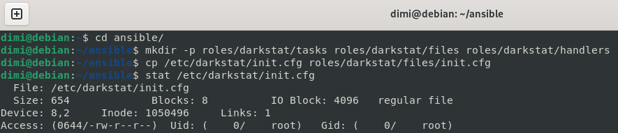

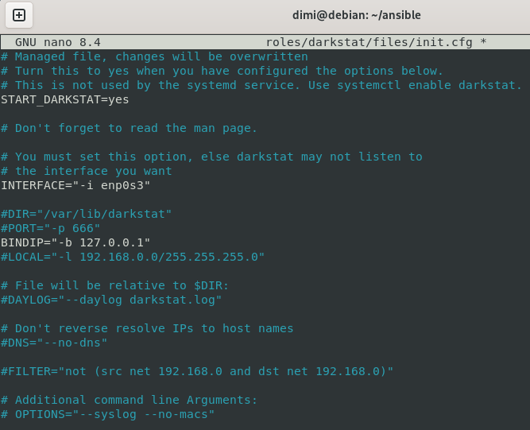

```
cd ansible
mkdir -p roles/darkstat/tasks roles/darkstat/files roles/darkstat/handlers

cp /etc/darkstat/init.cfg roles/darkstat/files/init.cfg
stat /etc/darkstat/init.cfg

nano roles/darkstat/files/init.cfg

# Managed file, changes will be overwritten
```

#### Sen jälkeen poistin darkstatin. Yllättäen prosessi oli edelleen käynnissä vielä poiston jälkeen, joten pysäytin sen ja tarkistin uudelleen. (`ps`-komennossa oli pieni kirjoitusvirhe)

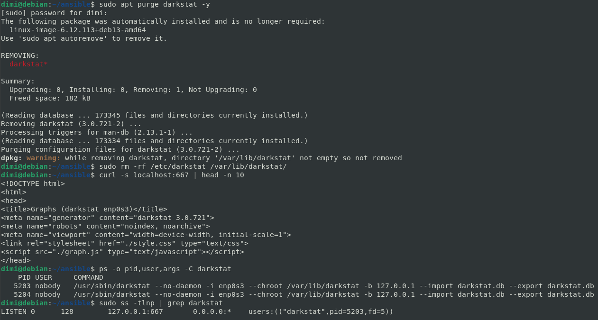

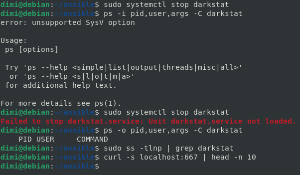

```
sudo apt purge darkstat -y
sudo rm -rf /etc/darkstat /var/lib/darkstat

curl -s localhost:667 | head -n 10
ps -o pid,user,args -C darkstat
sudo ss -tlnp | grep darkstat

sudo systemctl stop darkstat
```

#### Mitä tapahtui? `apt purge` poisti ohjelman tiedostot levyltä, mutta ei pysäyttänyt jo käynnissä olevaa prosessia. Linuxissa käynnissä oleva ohjelma jatkaa toimintaansa muistista, vaikka sen tiedosto poistettaisiin. Myös systemd piti palvelun tiedot edelleen muistissa. Paketin poistaminen ei siis aina tarkoita, että palvelu on pysähtynyt, joten kannattaa tarkistaa myös `ps`- ja `ss`-komennoilla.

#### Seuraavaksi loin tuttuun tapaan tehtävät ja handlerin sekä lisäsin roolin `site.yml`-tiedostoon. Rooli toimii samalla tavalla kuin edellisessä tehtävässä: `apt` asentaa paketin, `copy` kopioi asetustiedoston ja ilmoittaa handlerille, ja `service` pitää darkstatin käynnissä.

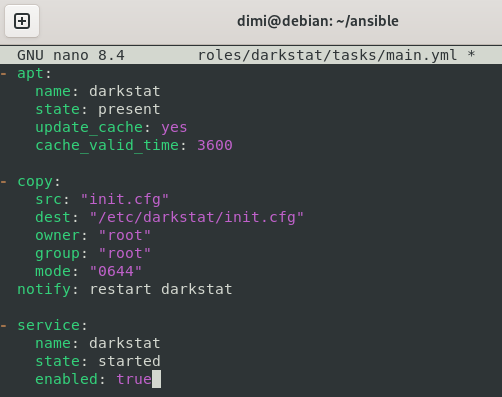

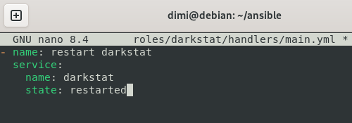

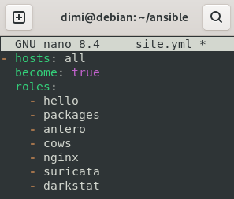

```
nano -E roles/darkstat/tasks/main.yml

# tasks/main.yml tiedosto
- apt:
    name: darkstat
    state: present
    update_cache: yes
    cache_valid_time: 3600

- copy:
    src: "init.cfg"
    dest: "/etc/darkstat/init.cfg"
    owner: "root"
    group: "root"
    mode: "0644"
  notify: restart darkstat

- service:
    name: darkstat
    state: started
    enabled: true
```
```
nano -E roles/darkstat/handlers/main.yml

# handlers/main.yml tiedosto
- name: restart darkstat
  service:
    name: darkstat
    state: restarted
```
```
nano -E site.yml

# site.yml tiedosto
- hosts: all
  become: true
  roles:
    - hello
    - packages
    - antero
    - cows
    - nginx
    - suricata
    - darkstat
```

#### Lopuksi ajoin playbookin kahdesti ja testasin. Darkstat toimi taas osoitteessa `127.0.0.1:667` uusilla prosessinumeroilla ja samoilla asetuksilla kuin manuaalisesti asennettu.


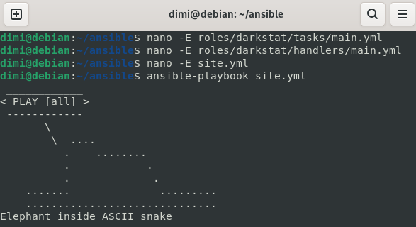

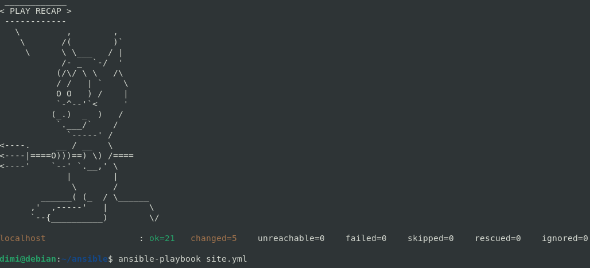

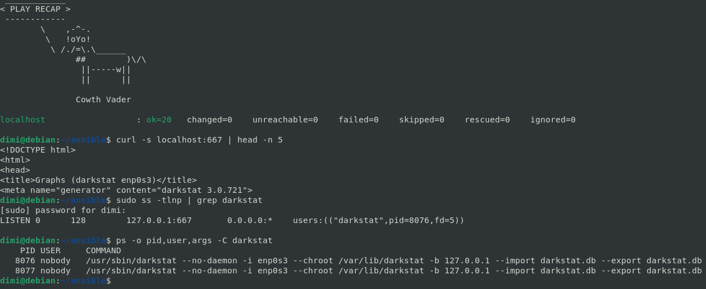

```
ansible-playbook site.yml

curl -s localhost:667 | head -n 5
sudo ss -tlnp | grep darkstat
ps -o pid,user,args -C darkstat
```

## c) Asetus

#### Muutin roolin asetustiedostossa portin 667:tä 6677:ään ja ajoin playbookin.

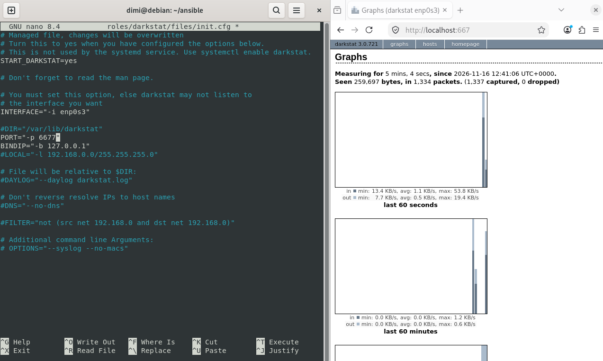

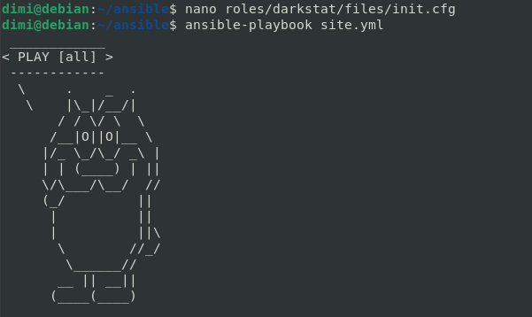

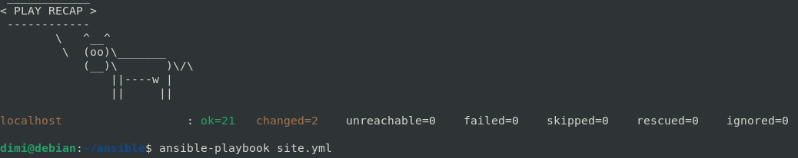

```
nano roles/darkstat/files/init.cfg

# konfigurointi tiedosto
PORT="-p 6677"

ansible-playbook site.yml
```

#### Tarkistin, että muutos astui voimaan. `ss` näytti darkstatin kuuntelevan porttia 6677 ja sivu vastasi uudessa portissa sekä komentorivillä että selaimella. Vanhaan porttiin 667 ei enää saanut yhteyttä.

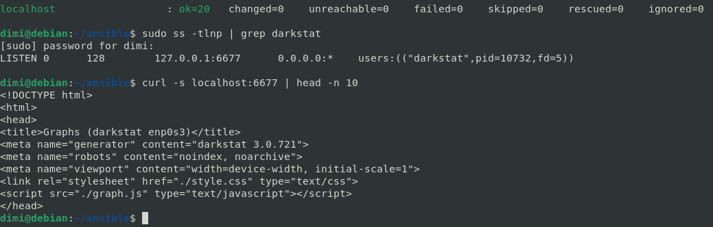

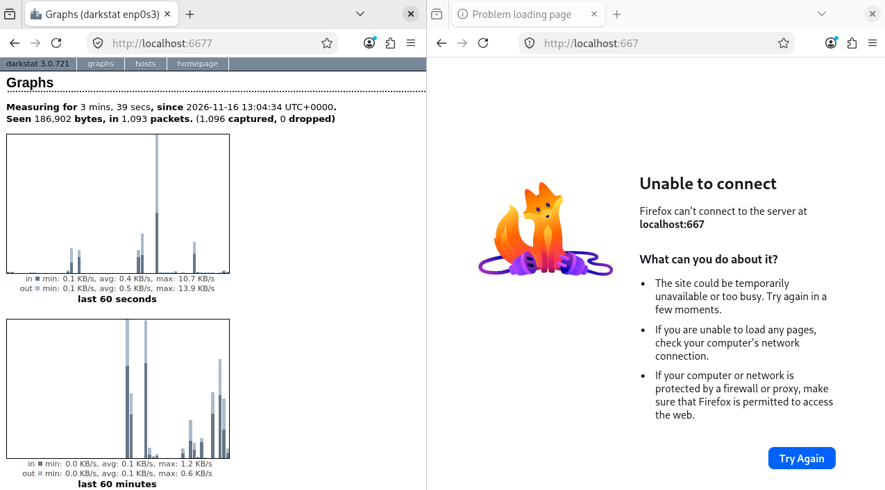

```
sudo ss -tlnp | grep darkstat
curl -s localhost:6677 | head -n 10
```

## d) Paikka remonttiin

#### Ensin pysäytin darkstatin, koska purge ei pysäytä sitä. Sitten poistin darkstatin ja sen tiedostot. Lisäksi varmistin, ettei mitään ollut enää käynnissä eikä portti vastannut.

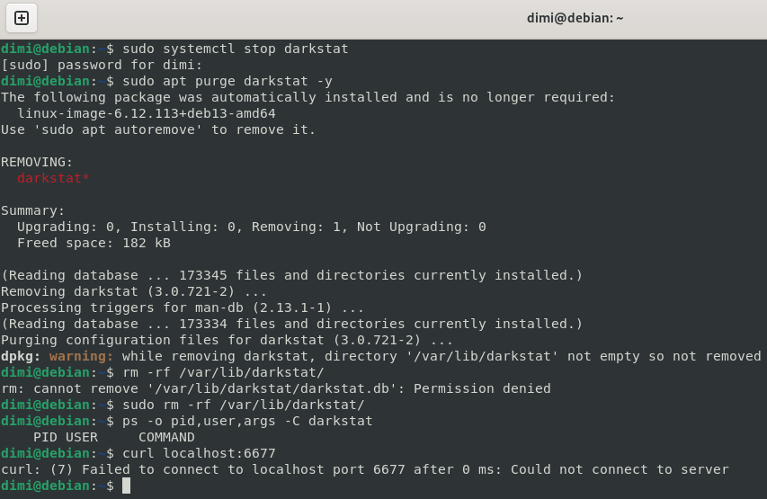

```
sudo systemctl stop darkstat

sudo apt purge darkstat -y
sudo rm -rf /var/lib/darkstat

ps -o pid,user,args -C darkstat
curl localhost:6677
```

#### Seuraavaksi ajoin playbookin ja testasin, että Ansible korjasi kaiken. Darkstat asentui uudelleen, asetustiedosto palautui ja palvelu vastasi taas portissa 6677.

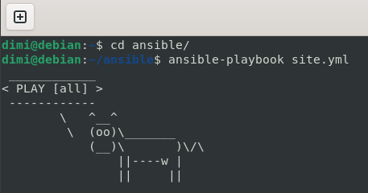

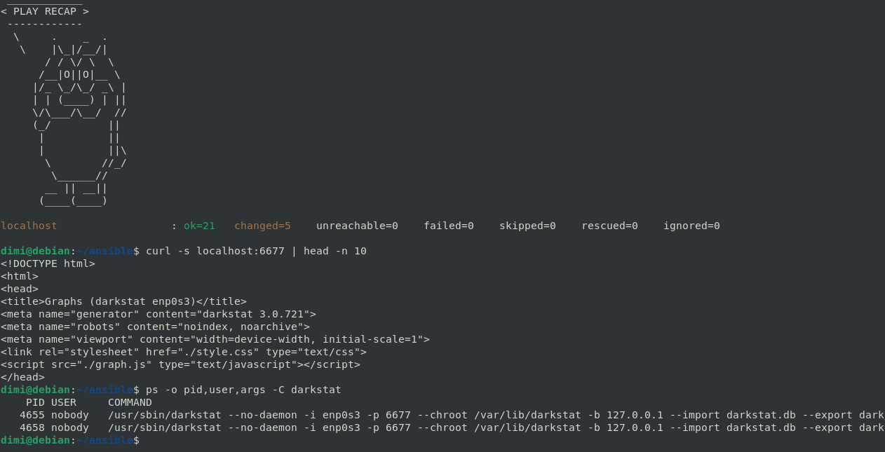

```
ansible-playbook site.yml

curl -s localhost:6677 | head -n 10
ps -o pid,user,args -C darkstat
```


## e) Idempotentti

#### Lopuksi ajoin playbookin vielä kerran. Tulos oli `changed=0` eli mitään ei tarvinnut muuttaa, joten tila on idempotentti. Selkeyden vuoksi otin lehmät hetkeksi pois (`nocows`) ja lisäsin `display_args_to_stdout`-asetuksen, jolloin jokaisen tehtävän argumentit näkyvät tulosteessa.

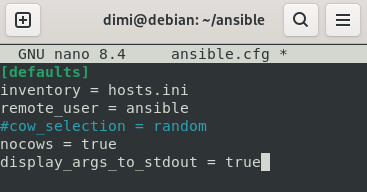

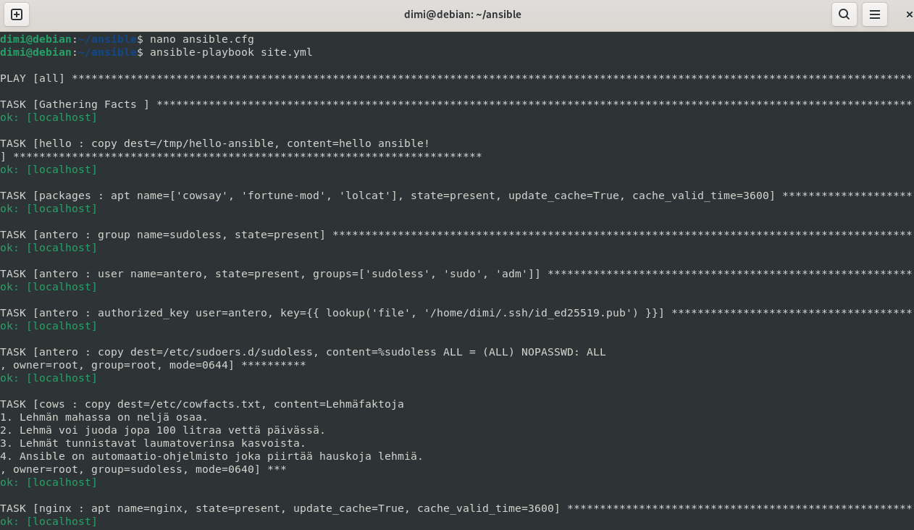

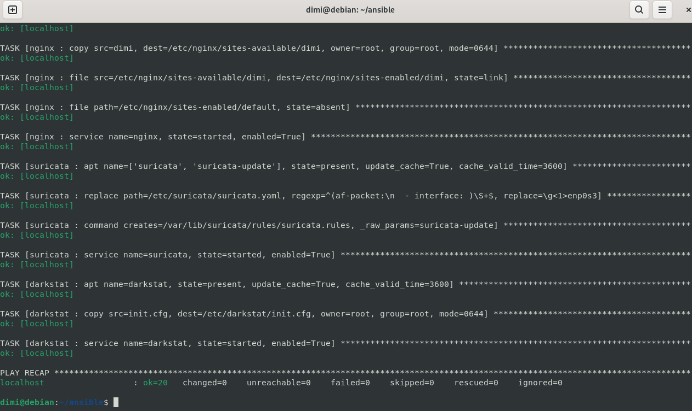

```
nano ansible.cfg

# ansible.cfg tiedosto
[defaults]
inventory = hosts.ini
remote_user = ansible
#cow_selection = random
nocows = true
display_args_to_stdout = true

ansible-playbook site.yml
```

## Teknisiä vaikeuksia

Ei ollut varsinaisia teknisiä vaikeuksia. Tällä viikolla aika oli vähissä, niin valitsin suht selkeän ohjelmiston tähän tehtävään. En ole tehnyt varsinaisesti mitään ihmeellistä, ihan perus homma.

## Lähteet:

[Karvinen 2026: Palvelinten Hallinta](https://terokarvinen.com/palvelinten-hallinta/)

[Emil Mikulic: darkstat](https://unix4lyfe.org/darkstat/)