# h5 Gitar Hero

## x) Lue ja tiivistä

**Chacon and Straub 2014: Pro Git, 2ed: 1.3 Getting Started - What is Git?**

Artikkeli kertoo, miten Gitti toimii ja eroaa muista versionhallintajärjestelmistä. Käytännössä kun ihminen ymmärtää Gitin perusajatuksen, sen käyttö on paljon helpompaa.

- **Snapshotit:** Useimmat versionhallinnat tallentavat tiedostoihin tehdyt muutokset. Git tallentaa jokaisesta commitista snapshotin eli "kuvan" koko projektista. Muuttumattomia tiedostoja ei tallenneta uudestaan, vaan Git linkittää aiempaan versioon.
- **Paikalliset toiminnot:** Koko historia on omalla koneella. Historian selaaminen sekä muutosten vertailu on nopeaa ja committeja voi tehdä offlinessa ja pushata myöhemmin.
- **Checksum:** Git laskee kaikesta SHA-1-tarkistussumman ja tunnistaa tiedot sen perusteella. Jos jokin muuttuu tai korruptoituu, Git huomaa sen.
- **Git vain lisää dataa:** Perusajatus on se, että lähes kaikki toiminnot lisäävät tietoa eivätkä poista niitä, joten commitattua työtä on vaikea menettää. Toki commitoimattomat muutokset voi kuitenkin menettää.
- **Kolme tilaa:** Tiedosto on joko modified (muokattu), staged (merkitty seuraavaan commitiin) tai committed (tallennettu paikalliseen tietokantaan). Näitä vastaavat working tree, staging area ja .git-hakemisto.

**Oma kysymys tai huomio**

Se, että "Git vain lisää dataa" on myös potentiaalinen tietoturvariski. Jos vahingossa commitoi salasanan tai API-avaimen ja poistaa sen seuraavassa commitissa, se jää silti historiaan ja jokainen kloonaaja saa sen.

**Lähteet:**

Chacon & Straub 2014: Pro Git, 2ed: [1.3 Getting Started - What is Git?](https://git-scm.com/book/en/v2/Getting-Started-What-is-Git%3F)

**'git add --all && git commit; git pull && git push'. Selitä tuon komennon jokainen osa.**

- **git add --all** - lisää kaikki muutokset staging arealle eli seuraavaan commitiin. Mukaan tulevat uudet, muutetut ja poistetut tiedostot koko työhakemistosta.
- **git commit** - tallentaa staging arean sisällön uutena committina paikalliseen repoon. Ilman `-m`-valitsinta avautuu editori commit-viestiä varten.
- **git pull** - hakee etärepon muutokset. Pull tehdään ensin, koska etärepo hylkää pushin, jos siellä on committeja, joita omalla koneella ei ole.
- **git push** - lähettää omat commitit etärepoon.
- **&&** - ajaa seuraavan komennon vain, jos edellinen onnistui.
- **;** - ajaa seuraavan komennon joka tapauksessa.

**Oma kysymys tai huomio**

Tässä pitäisi muistaa, että `git add --all` lisää muutokset koko reposta, vaikka olisi alikansiossa, kun taas `git add .` lisää vain nykyisen kansion ja sen alikansiot.

**Lähteet:**
- [git-add](https://git-scm.com/docs/git-add)
- [git-commit](https://git-scm.com/docs/git-commit)
- [git-pull](https://git-scm.com/docs/git-pull)
- [git-push](https://git-scm.com/docs/git-push)
- [&& and ; commands](https://www.gnu.org/software/bash/manual/html_node/Lists.html)


## a) Online

#### Loin GitHubiin uuden repon tehtävän vaatimuksilla.

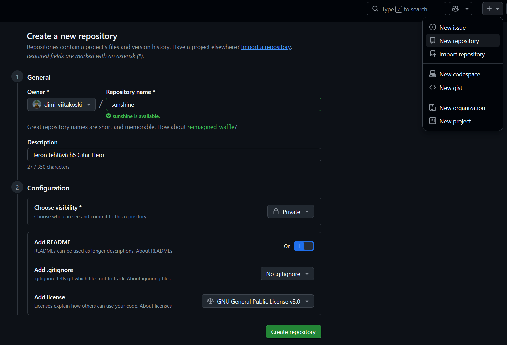

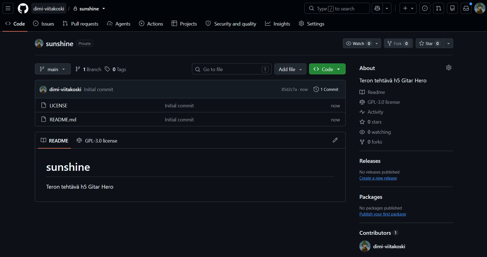

## b) Dolly

#### Ensin tarkistin uuden repon SSH-osoitteen.

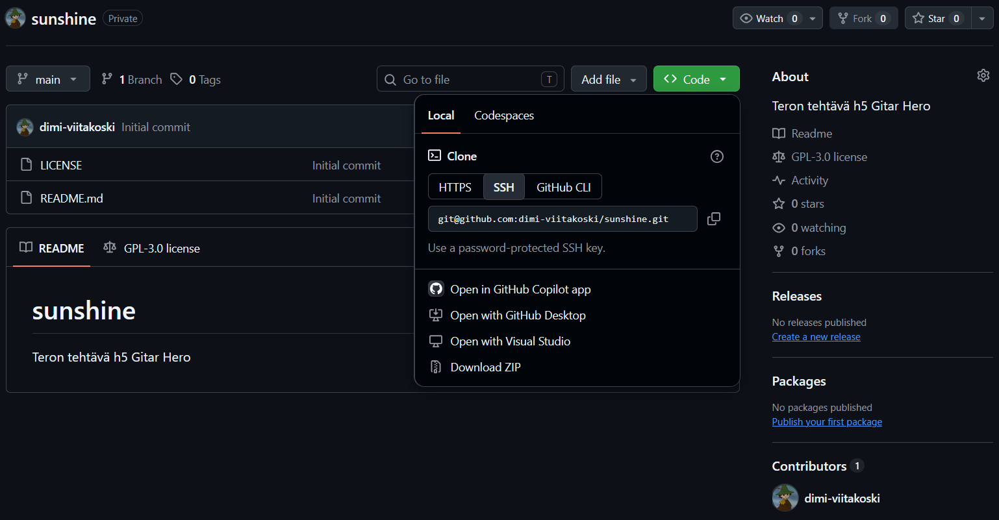

#### Seuraavaksi tein GitHub-repoille oman kansion, kloonasin repon (unohdin komennosta .git-päätteen, mutta se ei ole pakollinen), loin tiedoston ja tarkistin tilanteen.

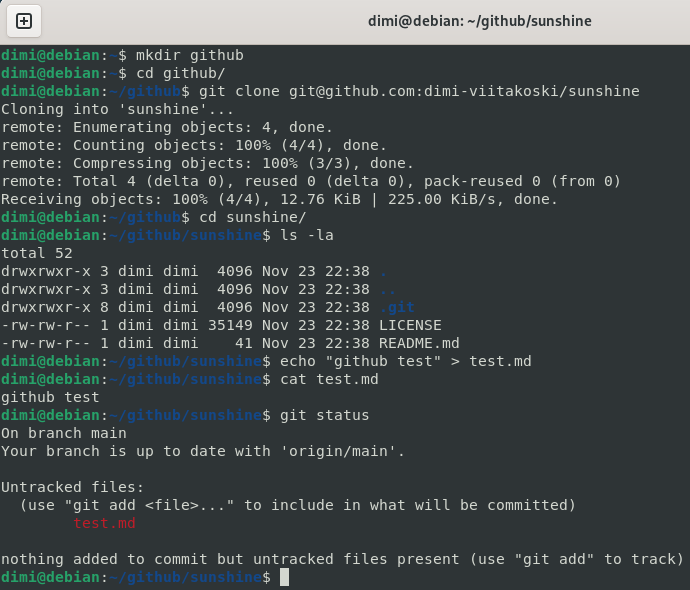

```bash
mkdir github
cd github

git clone git@github.com:dimi-viitakoski/sunshine
cd sunshine
ls -la

echo "github test" > test.md
cat test.md
git status
```
#### Lisäsin tiedoston, tein commitin viestin kanssa sekä lopuksi pull, push ja tarkistus.

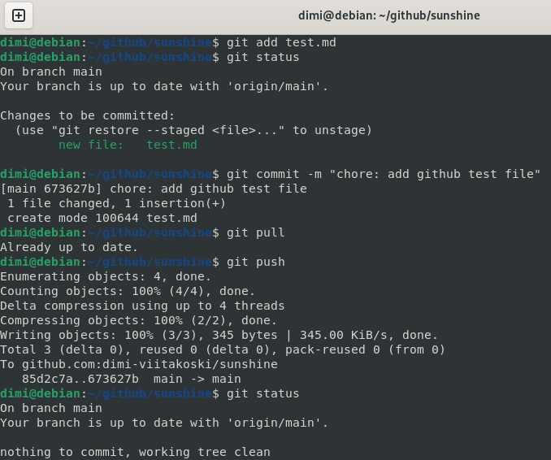

```bash
git add test.md
git status

git commit -m "chore: add github test file"

git pull
git push
git status
```

#### Lopuksi tarkistin login ja repon selaimella.

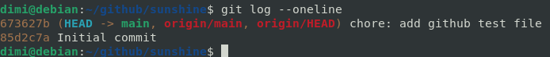

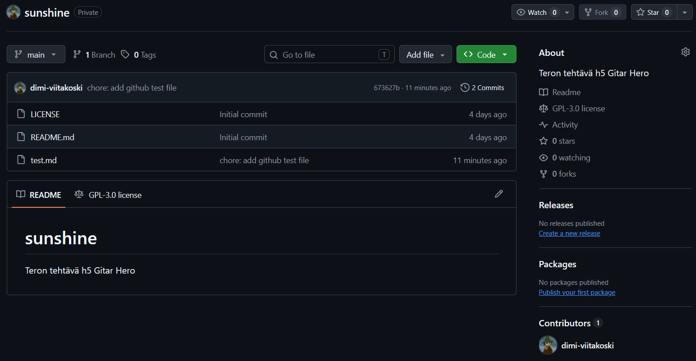

```bash
git log --oneline
```

## c) Doh!

#### Tein virheen ylikirjoittamalla README-tiedoston.

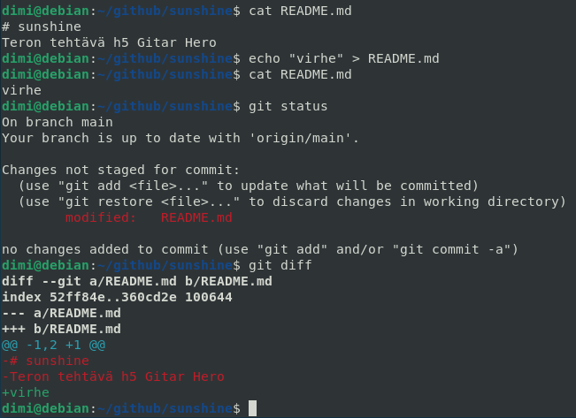

```bash
cat README.md
echo "virhe" > README.md
cat README.md

git status
git diff
```

#### Korjasin virheen `git reset --hard` -komennolla ja tarkistin.

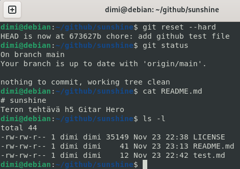

```bash
git reset --hard
git status

cat README.md
ls -l
```

## d) Tukki

#### Tarkistin login sekä äsken tehdyn commitin ja lopuksi koko historian. Logista näkyy jokaisen commitin tunniste (hash), tekijä, sähköposti, päivämäärä ja viesti. `git show` näyttää lisäksi itse muutoksen ja `--stat` muutetut tiedostot.

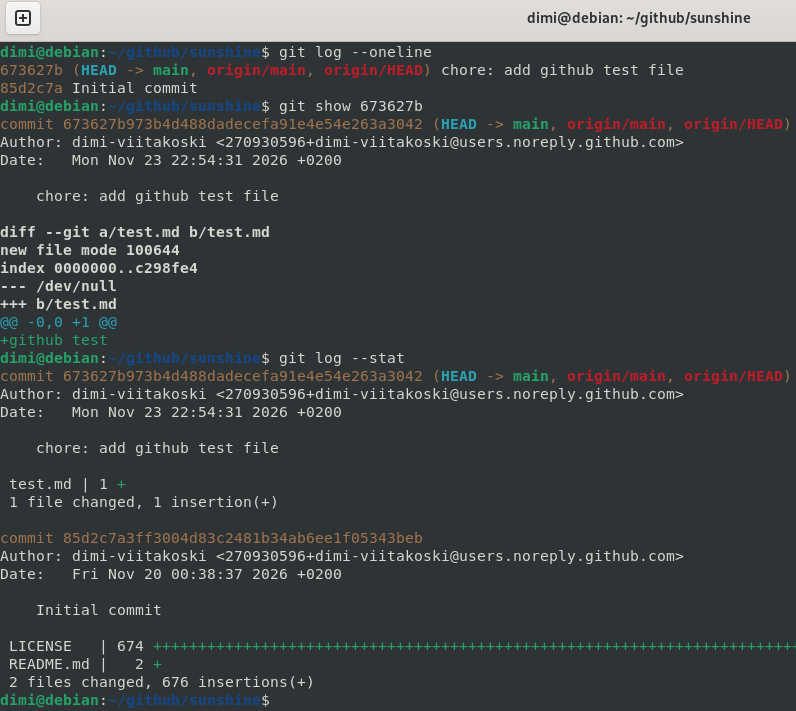

```bash
git log --oneline
git show 673627b

git log --stat
```

## e) Gitanbile

#### Siirryin aiemmissa tehtävissä tehtyyn ansible-kansioon ja tein siitä Git-repon komennolla `git init`. Tämä luo piilotetun .git-kansion, johon versiohistoria tallentuu. Lisäsin kaikki tiedostot `git add --all`-komennolla ja tein ensimmäisen commitin, johon tuli 15 tiedostoa. Lopuksi tarkistin login.

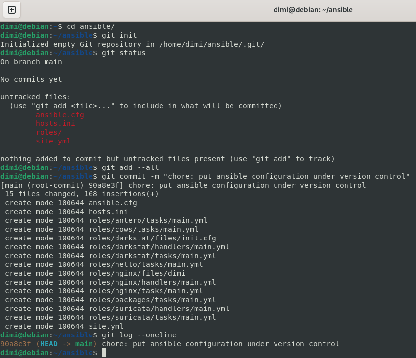

```bash
cd ansible

git init
git status

git add --all
git commit -m "chore: put ansible configuration under version control"

git log --oneline
```

#### Muutin edellisessä harjoituksessa asennetun darkstatin weppiliittymän porttia, tarkistin muutoksen, ajoin playbookin ja varmistin, että portti vaihtui.

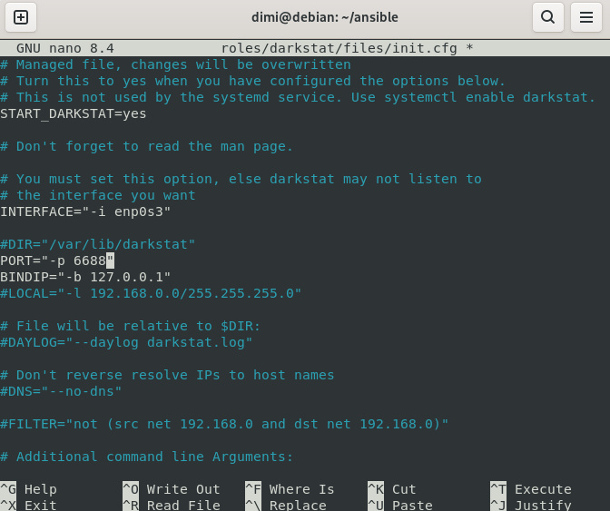

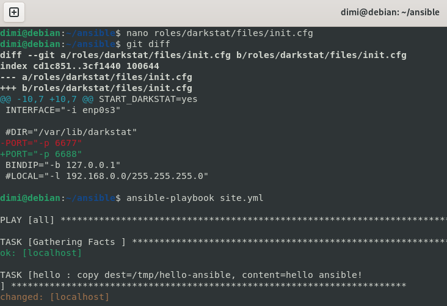

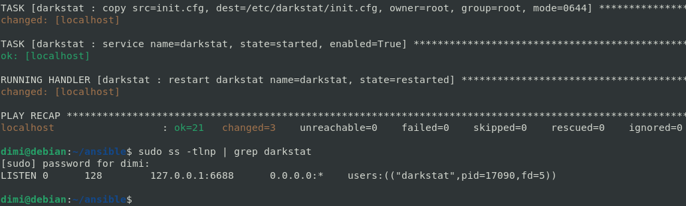

```bash
nano roles/darkstat/files/init.cfg
git diff

ansible-playbook site.yml

sudo ss -tlnp | grep darkstat
```

#### Tallensin muutoksen versionhallintaan ja tarkistin.

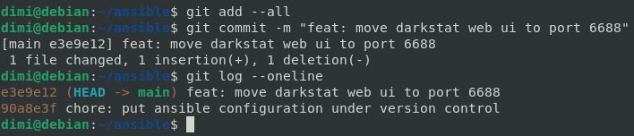

```bash
git add --all
git commit -m "feat: move darkstat web ui to port 6688"

git log --oneline
```

## f) Hae pari projektiin Moodlen keskustelusta.
> Sain Terolta luvan tehdä projektin yksin.

## g) Vapaaehtoinen: Se toinen järjestelmä

#### Minulla oli Git jo käytössä Windowsilla, joten valitsin sen. Asennus hoituu yhdellä powershell komennolla. Windowsilla kirjauduin GitHubiin HTTPS-osoitteella SSH-avaimen sijaan vaihteeksi. Kirjautuminen siis hoituu Git for Windowsin mukana tulevalla Git Credential Managerilla. Se kirjautuu kerran selaimen kautta ja muistaa kirjautumisen sen jälkeen. Sen voi tarkistaa komennolla `git config --get-all credential.helper`.

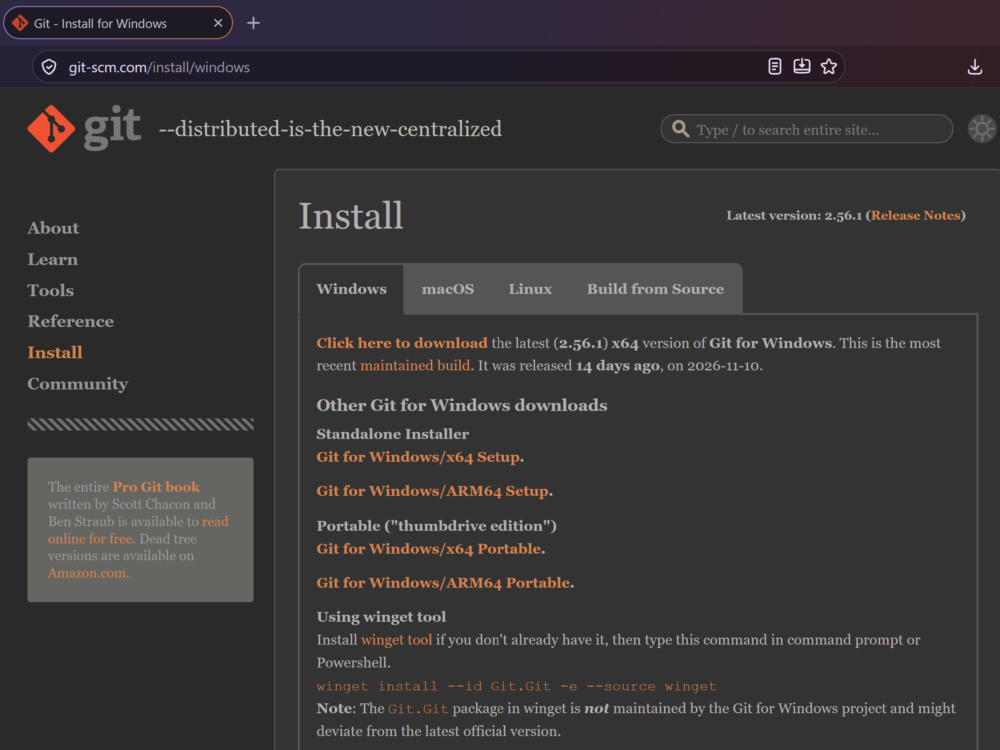

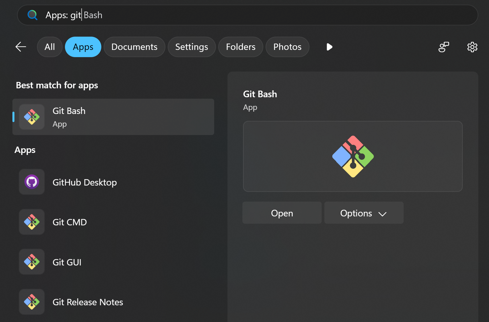

```powershell
winget install --id Git.Git -e --source winget
```

#### Muuten käyttö on siis täsmälleen samanlaista kuin Debianissa. Ainoa ero oli varoitus rivinvaihdoista, mikä on Windowsilla ihan normaalia.

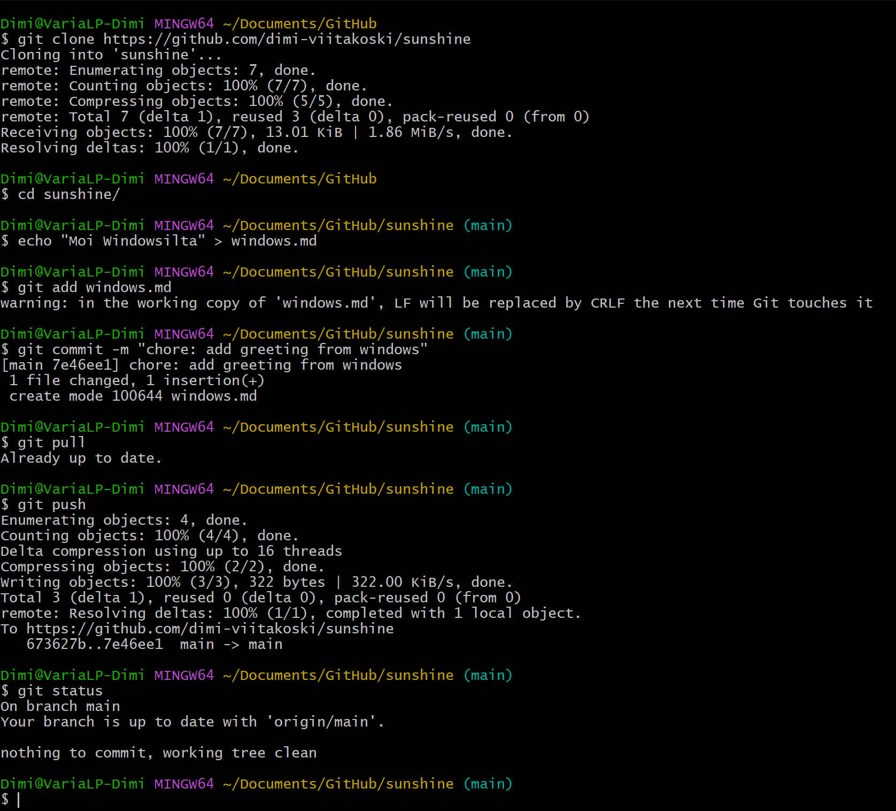

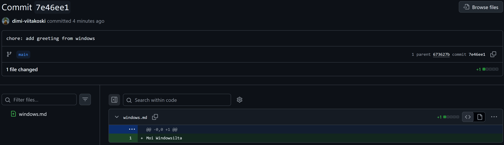

```bash
git clone https://github.com/dimi-viitakoski/sunshine

cd sunshine
echo "Moi Windowsilta" > windows.md

git add windows.md
git commit -m "chore: add greeting from windows"
git pull
git push
git status
```

## h) Vapaaehtoinen: yhteistyötä

#### Noh, minulla ei ole, eikä ole ollut kavereita pitkiin aikoihin, mutta eihän niitä tarvitsekaan, kun eletään mahtavaa tulevaisuutta. Yritin tehdä hello world-skriptin, mutta se ei toimi, enkä millään saanut ongelmaa ratkaistua. Pushasin sen GitHubiin ja pyysin commit-viestissä apua.

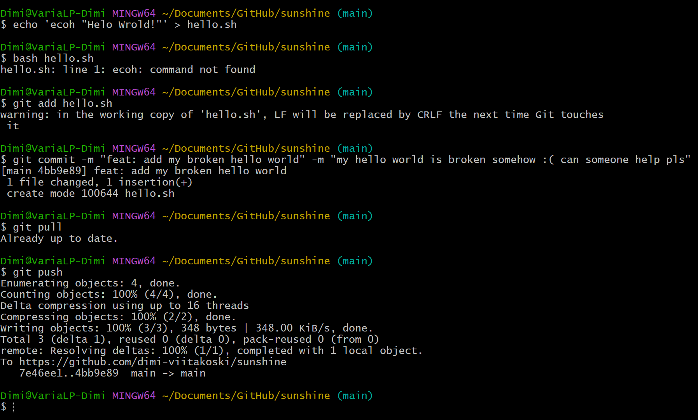

#### Onneksi apua sai heti :)

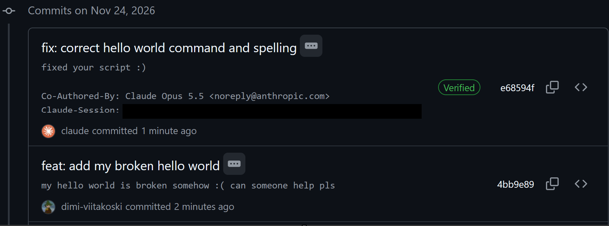

```bash
echo 'ecoh "Helo Wrold!"' > hello.sh
bash hello.sh
git add hello.sh

git commit -m "feat: add my broken hello world" -m "my hello world is broken somehow :( can someone help pls"
git pull
git push
```
#### Hain korjatun skriptin ja ajoin sen uudestaan. Se toimii! Lopuksi tarkistin vielä login.

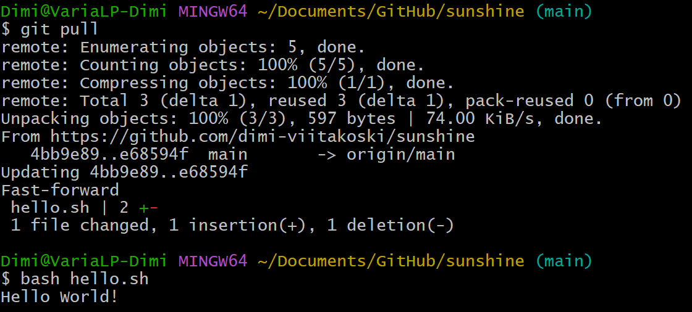

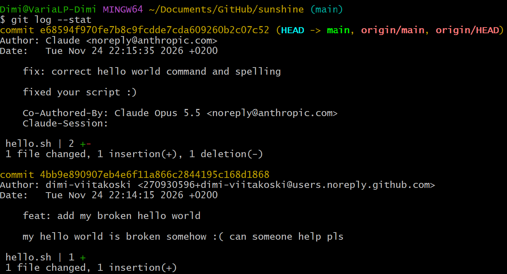

```bash
git pull
bash hello.sh

git log --stat
```

#### Minun avustaja sai pääsyn GitHub-sovelluksen kautta ja pääsy on rajattu valittuihin repoihin. Alla ovat komennot, joita avustaja käytännössä teki.

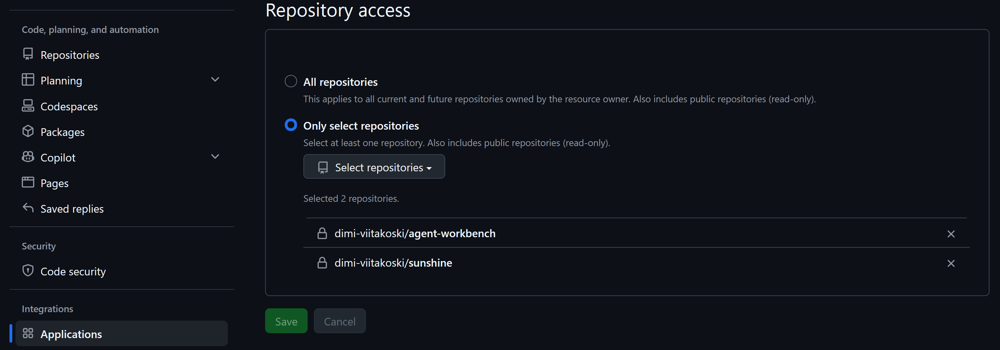

```bash
git clone https://github.com/dimi-viitakoski/sunshine
cd sunshine
bash hello.sh
echo 'echo "Hello World!"' > hello.sh
bash hello.sh
git add hello.sh
git commit -m "fix: correct hello world command and spelling" -m "fixed your script :)"
git pull
git push
```

## Teknisiä vaikeuksia

Teknisiä vaikeuksia ei ollut, mutta tehtävä oli silti hyvä kertaus. Olen käyttänyt jo pitkään graafista [GitHub Desktopia](https://docs.github.com/en/desktop/installing-and-authenticating-to-github-desktop/installing-github-desktop), joten jouduin vähän palauttamaan komentoja mieleen. GitHub Desktop on muuten aika kiva ja sillä hoituvat kaikki perushommat kätevästi.

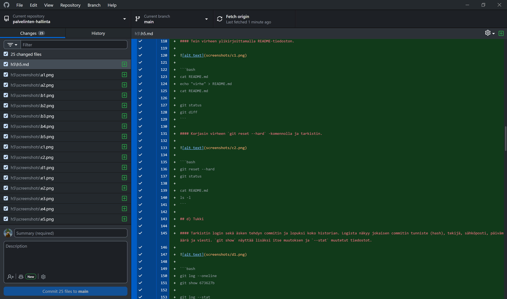

Toki komentoriviä kannattaa silti osata käyttää jollain tasolla. Kerran esimerkiksi lisäsin tiedostoja yhteen projektirepoon ja laitoin vahingossa väärän versiotagin. Sitä ei saanut GitHub Desktopilla mitenkään pois, joten jouduin poistamaan versiotagin komentorivillä.


## Lähteet:

[Karvinen 2026: Palvelinten Hallinta](https://terokarvinen.com/palvelinten-hallinta/)

[Chacon & Straub 2014: Pro Git, 2ed](https://git-scm.com/book/en/v2/Getting-Started-What-is-Git%3F)